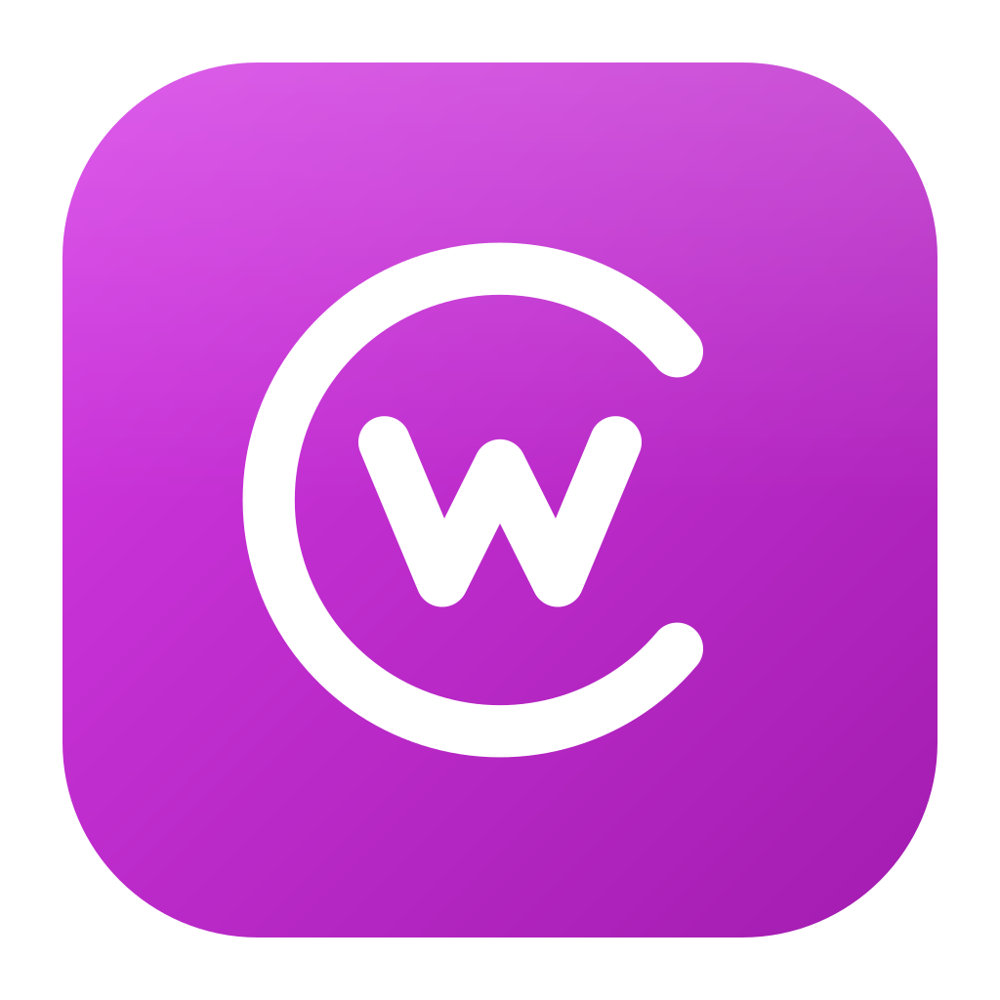
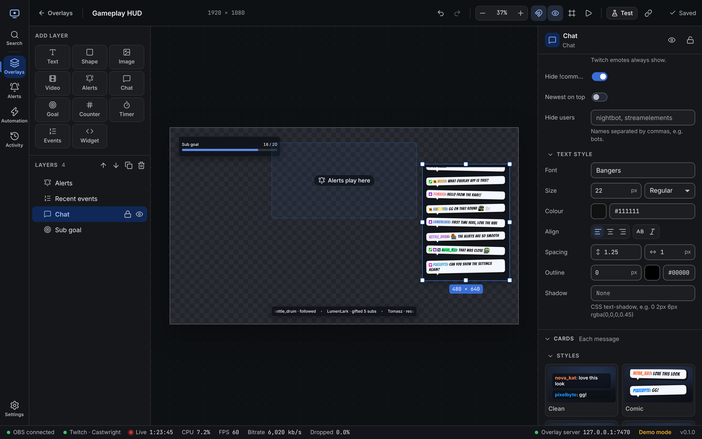

<p align="center">
  
</p>

<h1 align="center">Castwright</h1>

<p align="center">
  Overlays, alerts, chat and automation for Twitch, in one desktop app.<br />
  Free, open source and local: your data stays on your computer.
</p>

<p align="center">
  <a href="https://castwright.sinist3r.lol">Guide</a> ·
  <a href="https://github.com/AmeliaFromFinance/castwright/releases/latest">Download</a> ·
  <a href="https://castwright.sinist3r.lol/gallery/">Screenshots</a>
</p>

<p align="center">
  
</p>

## What it does

- **Overlay editor**: drag-and-drop text, images, video, goals, timers, chat, event lists and alerts. Add them to OBS in one click.
- **Styles**: comic, neon, pixel, sticker and more, with full control of shapes, fills, borders, shadows and tilt, plus custom CSS.
- **Chat**: Twitch and 7TV badges, 7TV name paints, and 7TV, BetterTTV and FrankerFaceZ emotes.
- **Alerts**: follows, subs, gifts, cheers, raids, redemptions and more, with variations, conditions, sounds and animations.
- **Automation**: chat commands, timers and reactions to events, shown as a flow. Send chat, switch scenes, toggle sources, run scripts and call web hooks.
- **Custom widgets**: HTML, CSS and JS layers that run many StreamElements custom widgets.
- **Themes**: dark, light, high contrast and your own, with a built-in contrast checker.

Castwright works with **Twitch** and **OBS Studio 28+** on Windows 10/11, macOS 11+ and Linux.

## Install

Download the installer for your system from [Releases](https://github.com/AmeliaFromFinance/castwright/releases/latest), then follow the [install guide](https://castwright.sinist3r.lol/guide/install/).

## Build from source

```sh
npm ci
npm run tauri dev
```

Needs Node.js 22, Rust 1.90+ and the [Tauri prerequisites](https://v2.tauri.app/start/prerequisites/). See [Build from source](https://castwright.sinist3r.lol/development/) for tests and project layout.

## Licence

[MIT](LICENSE). Not affiliated with Twitch or the OBS Project.
