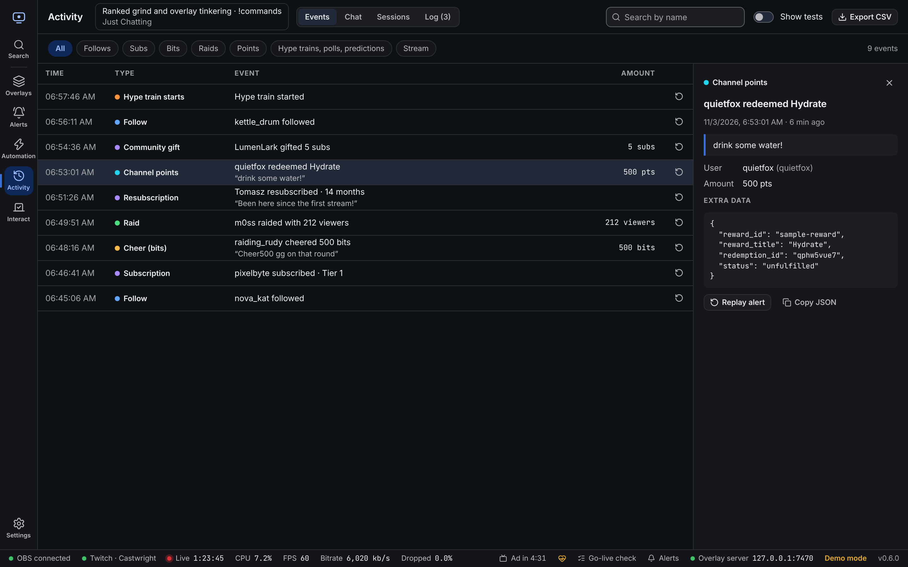
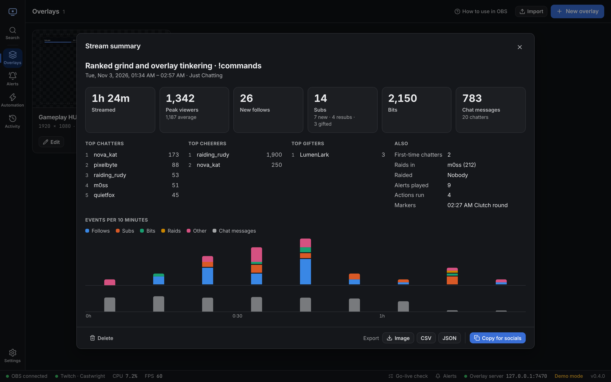

**Activity** keeps a record of what happened on your stream, shows chat, sums up past streams and holds your stream title.

Click the title at the top to change your **title**, **category** and **tags** on Twitch.

## Events

Every follow, sub, cheer, raid, redemption, hype train, poll and prediction is saved.

- Use the chips to show only some types, or search by name.
- **Show tests** includes events made with the Test buttons.
- Click a row to see all its details, including the raw data Twitch sent.
- Click ↺ to play the alert again.
- **Export CSV** saves the history as a spreadsheet file (up to the latest 5,000 events).

To delete the history, use **Settings → Backups and data → Clear history**.

## Chat

A full-size chat view with Twitch and 7TV badges, 7TV name paints and 7TV, BetterTTV and FrankerFaceZ emotes. The options button turns each of those on or off. You can send messages as yourself or as your bot.

## Sessions and summary

Each stream you do is saved as a **session**, from going live to going offline. When the stream ends, a **Stream summary ready** message pops up. Click **View** to open it.

To find it later:

- **Activity → Sessions** lists every past stream. Click one to open its summary.
- In the command palette (<kbd>Ctrl</kbd> + <kbd>K</kbd>), pick **Last stream summary** or **Past streams**.

### What's in a summary

| | |
| --- | --- |
| **Streamed** | How long you were live. |
| **Peak viewers** | Most viewers at once, plus the average. Needs Twitch. |
| **New follows** | Follows during the stream. |
| **Subs** | New subs, resubs and gifted subs, plus who gifted the most. |
| **Bits** | Bits cheered, plus the top cheerers. |
| **Chat messages** | Messages, how many people chatted and the top chatters. Your own messages, your bot and messages Castwright sent don't count. |
| **First-time chatters** | People whose first message Castwright ever saw came during this stream. On your first recorded stream, everyone counts as new. |
| **Raids** | Who raided you (and with how many viewers) and who you raided. |
| **Donations** | Twitch charity donations, if any. |
| **Alerts, actions, markers** | Alerts played, automation actions run and stream markers added. |
| **Events per 10 minutes** | Bars for follows, subs, bits, raids and other events, with chat below. Hover a bar to see the numbers. |

Test events never count.

### Share and save

- **Copy for socials** copies a short text, ready to paste into a post. Change the text in [Settings → Stream summary](/guide/settings/#stream-summary).
- **Export** saves the summary as an **Image** (PNG, sized for social posts), **CSV** (opens in any spreadsheet app) or **JSON**.
- **Delete** removes the stream and its chat, alert and action counts. Your event history stays. A live stream can't be deleted until it ends.

### How streams are detected

- **Twitch** decides when a stream starts and ends. The start time comes from Twitch, so a summary covers the whole stream even if you open Castwright late.
- **Without a Twitch sign-in**, Castwright uses OBS: the session starts when OBS starts streaming and ends when it stops. Viewer numbers need Twitch.
- **If the stream drops** and comes back within 5 minutes, it continues the same session.
- **If Castwright closes mid-stream**, the session carries on when you open it again. If the stream ended while the app was closed, the session ends at the last time Castwright saw it live.
- Streams shorter than 1 minute (a quick test) aren't kept.
- Chat, alerts, actions, markers and raids out are only counted while Castwright is open.

## Log

Connection changes, automation runs and problems. Filter by level or source, and use **Copy** to paste the log into a bug report.
