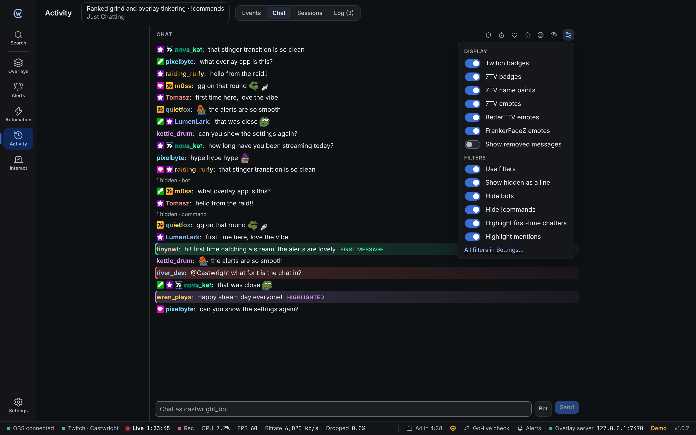
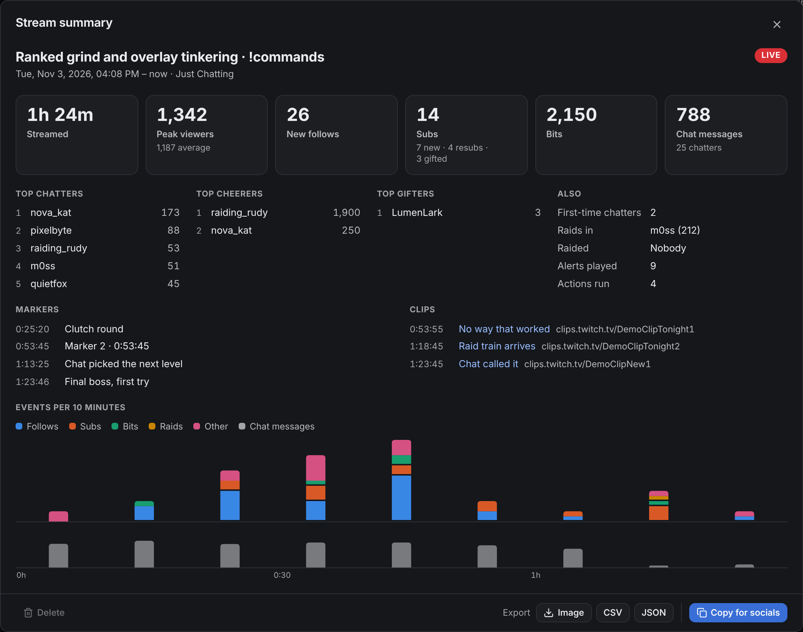

**Activity** keeps a record of what happened on your stream, shows chat, sums up past streams and holds your stream title.

Click the title at the top to change your **title**, **category** and **tags** on Twitch.

## Events

Every follow, sub, cheer, raid, redemption, hype train, poll and prediction is saved.

- Use the chips to show only some types, or search by name.
- **Show tests** includes events made with the Test buttons.
- Click a row to see all its details, including the raw data Twitch sent.
- Click ↺ to play the alert again.
- **Export CSV** saves the history as a spreadsheet file (up to the latest 5,000 events).

To delete the history, use **Settings → Backups and data → Clear history**.

## Chat

A full-size chat view with Twitch and 7TV badges, 7TV name paints and 7TV, BetterTTV and FrankerFaceZ emotes. The options button turns each of those on or off. You can send messages as yourself or as your bot.

### Filters and highlights

Chat hides noise and marks messages you shouldn't miss.

| Hides | |
| --- | --- |
| **Bots** | Nightbot, StreamElements, Streamlabs, Moobot, Fossabot, Sery_Bot, Wizebot and your own bot account. Edit the list in Settings. |
| **Commands** | Messages starting with `!` |
| **Users** | Names you list |
| **Words** | Words you list, whole words and any case. Write `/pattern/i` for a regular expression. |

| Highlights | |
| --- | --- |
| **First-time chatters** | The first message Castwright ever saw from someone. Marked **first message**. |
| **Mentions** | Messages with your name in them |
| **Keywords** | Words you list |
| **Users** | Names you list, and mods or VIPs if you turn them on |
| **Highlighted with points** | Twitch's "Highlight my message" reward. Marked **highlighted**. |

Each highlight has its own colour. Hover a highlighted message to see why.

The options button in the chat panel has quick switches for bots, commands, first-time chatters and mentions. **All filters in Settings…** opens [Settings → Chat filters](/guide/settings/#chat-filters) for the rest. These rules are shared with [chat layers](/guide/overlay-editor/#chat-layer-filters).

| Option | Default | |
| --- | --- | --- |
| **Use filters** | On | Off shows every message, unmarked. Only for this panel. |
| **Show hidden as a line** | Off | Hidden messages show as a short line, like **1 hidden · bot**. Click it to see them. |
| **Show removed messages** | Off | Messages Twitch removed stay, crossed out. Handy for mods. |

Filters only change what you see. Mod tools work on every message that shows, and hidden messages stay in chat on Twitch.

### Mod tools

Hover a message and click **⋯**, or right-click it, to open its menu:

| | |
| --- | --- |
| **Reply** | Your next message replies to it. <kbd>Esc</kbd> cancels. |
| **Copy message** | Copies the text. |
| **Viewer card** | See below. |
| **Shoutout** | Official Twitch shoutout. Only while you're live. |
| **Delete message** | Removes it from Twitch chat. |
| **Time out** | 1 minute, 10 minutes, 1 hour or 24 hours. **…** picks any length up to 14 days, with a reason. |
| **Ban…** | Asks first, with an optional reason. Shows **Unban** once they're banned. |

When Twitch removes a message, it disappears from the panel and from overlay chat layers right away. That covers deletes, timeouts, bans and chat clears, whether you did it here or on Twitch. Overlays that reload don't bring them back.

To see removed messages, turn on **Show removed messages** in the panel's options. They show crossed out and marked **removed**. The viewer card always shows them that way.

**Keyboard:** click a message (or <kbd>Tab</kbd> into chat), then use <kbd>↑</kbd> and <kbd>↓</kbd> to move.

| Key | Does |
| --- | --- |
| <kbd>D</kbd> | Delete the message |
| <kbd>T</kbd> | Time out the sender for 10 minutes |
| <kbd>B</kbd> | Ban the sender (asks first) |
| <kbd>Enter</kbd> | Open the message menu |

### Viewer card

Click a name in chat to open their card:

- how old the account is, how long they've followed and their sub tier
- their badges
- their messages from this session
- timeout, ban and shoutout buttons
- **Mod note**: your own note about them. It's only saved on this computer.

### Chat modes

The icons at the top of the chat panel turn chat modes on and off. A highlighted icon is on.

| Icon | Mode |
| --- | --- |
| Shield | Shield mode |
| Timer | Slow mode. Pick the wait between messages, 3 seconds to 2 minutes. |
| Heart | Followers-only. Pick how long people must have followed, from any follower to 3 months. |
| Star | Subs-only |
| Smile | Emote-only |
| Fingerprint | Unique chat (no repeated messages) |

Changes made on Twitch show up within a minute.

## Sessions and summary

Each stream you do is saved as a **session**, from going live to going offline. When the stream ends, a **Stream summary ready** message pops up. Click **View** to open it.

To find it later:

- **Activity → Sessions** lists every past stream. Click one to open its summary.
- In the command palette (<kbd>Ctrl</kbd> + <kbd>K</kbd>), pick **Last stream summary** or **Past streams**.

### What's in a summary

| | |
| --- | --- |
| **Streamed** | How long you were live. |
| **Peak viewers** | Most viewers at once, plus the average. Needs Twitch. |
| **New follows** | Follows during the stream. |
| **Subs** | New subs, resubs and gifted subs, plus who gifted the most. |
| **Bits** | Bits cheered, plus the top cheerers. |
| **Chat messages** | Messages, how many people chatted and the top chatters. Your own messages, your bot and messages Castwright sent don't count. |
| **First-time chatters** | People whose first message Castwright ever saw came during this stream. On your first recorded stream, everyone counts as new. |
| **Raids** | Who raided you (and with how many viewers) and who you raided. |
| **Donations** | Twitch charity donations, if any. |
| **Alerts, actions** | Alerts played and automation actions run. |
| **Markers** | Each stream marker: time into the stream and its note. See [Markers and clips](#markers-and-clips). |
| **Clips** | Clips made from Castwright: title and link. |
| **Events per 10 minutes** | Bars for follows, subs, bits, raids and other events, with chat below. Hover a bar to see the numbers. |

Test events never count.

### Markers and clips

Mark a moment or clip it without leaving your game:

- Set the **Add stream marker** and **Create clip** [hotkeys](/guide/settings/#hotkeys), or
- pick them in the command palette (<kbd>Ctrl</kbd> + <kbd>K</kbd>), or
- use the [automation steps](/reference/automation-steps/#chat-and-twitch).

They only work while you're live.

**Markers** get a name like "Marker 3 · 1:23:45" (number and time into the stream). A message lets you type a short note for about 10 seconds. Press <kbd>Enter</kbd> to save it. Twitch can't change a marker after it's made, so the note is kept by Castwright and shows in the summary, not on Twitch.

**Clips** take Twitch a few seconds. A message shows **Making a clip…**, then the clip's title and link with **Copy link** and **Open**. If Twitch takes longer than 15 seconds, you still get the link. It works a little later.

The summary lists both, with the time into the stream. Click a clip to open it. CSV and JSON exports include them too.

### Share and save

- **Copy for socials** copies a short text, ready to paste into a post. Change the text in [Settings → Stream summary](/guide/settings/#stream-summary).
- **Export** saves the summary as an **Image** (PNG, sized for social posts), **CSV** (opens in any spreadsheet app) or **JSON**.
- **Delete** removes the stream and its chat, alert and action counts. Your event history stays. A live stream can't be deleted until it ends.

### How streams are detected

- **Twitch** decides when a stream starts and ends. The start time comes from Twitch, so a summary covers the whole stream even if you open Castwright late.
- **Without a Twitch sign-in**, Castwright uses OBS: the session starts when OBS starts streaming and ends when it stops. Viewer numbers need Twitch.
- **If the stream drops** and comes back within 5 minutes, it continues the same session.
- **If Castwright closes mid-stream**, the session carries on when you open it again. If the stream ended while the app was closed, the session ends at the last time Castwright saw it live.
- Streams shorter than 1 minute (a quick test) aren't kept.
- Chat, alerts, actions, markers, clips and raids out are only counted while Castwright is open. Clips made on Twitch directly don't show up.

## Log

Connection changes, automation runs and problems. Filter by level or source, and use **Copy** to paste the log into a bug report.
