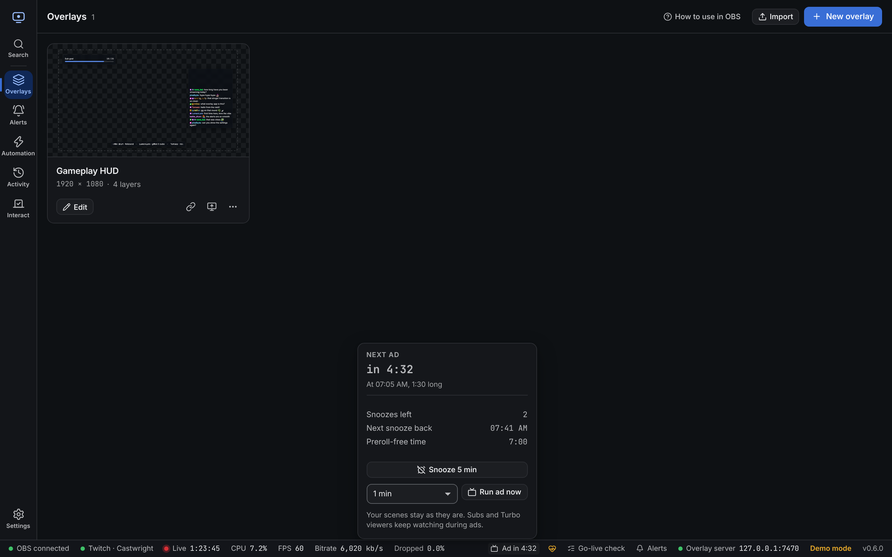
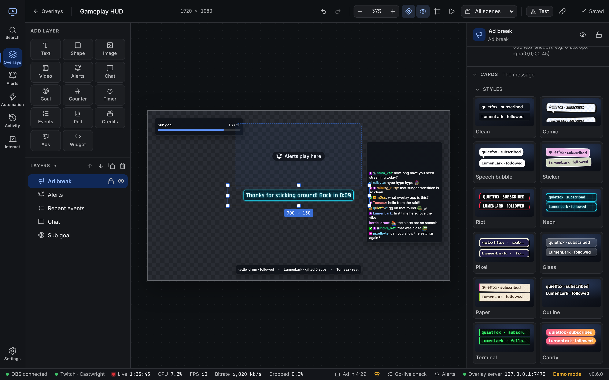
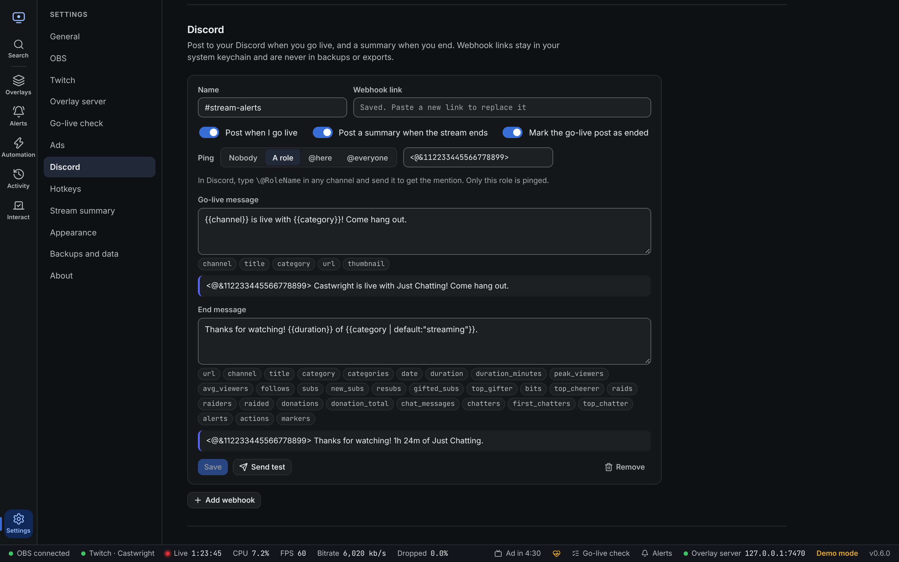

## Ads

### Castwright never switches scenes for ads

Subscribers and Turbo viewers don't see ads. They keep watching your stream the whole time. If an app swapped to a "be right back" scene, those viewers would stare at it for nothing, and it can look like the stream froze.

So Castwright leaves your scenes alone. It tells you when an ad is coming, and the [Ad break layer](#ad-break-layer) can show a small note on top of your normal scene.

### The status bar

While you're live, the status bar shows the next ad:

- **Ad in 4:32**: time until the next scheduled ad. It turns orange in the last minute.
- **Ad running 1:12**: an ad is on air, with the time left.

Click it to open the ad panel.

| Shows | Means |
| --- | --- |
| Next ad | When it starts and how long it is |
| Snoozes left | How many times you can push it back. Twitch adds one back every hour or so. |
| Preroll-free time | How long new viewers join without a preroll ad. Running ads earns more. |

- **Snooze 5 min** pushes the next ad back 5 minutes. It's greyed out with no snoozes left, or while an ad runs.
- **Run ad now** starts an ad straight away. Pick 30 seconds to 3 minutes first. Twitch has a cooldown between ads.

Castwright reads the schedule from Twitch every minute while you're live, and right after you snooze or run an ad.

### Heads-up before an ad

A message pops up 1 minute before each ad, with a **Snooze** button. It shows once per ad.

Change how early it shows, or turn it off, in [Settings → Ads](/guide/settings/#ads).

### Ad break layer

An overlay layer that tells viewers what's going on. It's hidden the rest of the time.

| Setting | Default | |
| --- | --- | --- |
| **Show before** | 30 s | Seconds before the ad. 0 shows it only during the ad. |
| **Before the ad** | `Ads in {{time}}, back soon` | Empty: nothing shows before the ad. |
| **During the ad** | `Thanks for sticking around! Back in {{time}}` | Subscribers and Turbo viewers see this. Empty: hidden during the ad. |

Both texts can use:

| Placeholder | Is |
| --- | --- |
| `{{time}}` | Countdown, like `0:30` |
| `{{seconds}}` | Same, in seconds |
| `{{length}}` | Length of the ad, like `1:30` |

Style the card under **Cards**. Pick one of the styles, then change anything you like. **Preview** switches the canvas between before and during the ad. Its CSS classes are in the [styling reference](/reference/styling/#ad-break).

### Automation

| Trigger | Runs |
| --- | --- |
| **Ad starting soon** | Some minutes before the next ad, once per ad |
| **Ad break begins** | When an ad starts, scheduled or run by hand |
| **Ad break ends** | When the ad is over |

Steps: **Run ad** and **Snooze ad**. See the [steps reference](/reference/automation-steps/#ads-and-discord).

Example: *Ad starting soon* (1 minute) → *Send chat message* "Ads in {{ad.time}}. Grab a drink!"

### Twitch permissions

Reading the schedule needs `channel:read:ads`. Running an ad needs `channel:edit:commercial`. Snoozing needs `channel:manage:ads`. If you signed in before snoozing was added, the panel says so. Sign out and in again in **Settings → Twitch** to use it.

## Discord

Post to your Discord server when you go live, and a summary when you stop.

### Add a webhook

1. In Discord, open **Server Settings → Integrations → Webhooks**.
2. Click **New Webhook**, pick the channel, then **Copy Webhook URL**.
3. In Castwright, open **Settings → Discord** and click **Add webhook**.
4. Paste the link, give it a name, and click **Save**.
5. Click **Send test** to check it works. Test posts never ping anyone.

You can add up to 10 webhooks, for example one per server.

:::caution[Keep the link private]
Anyone with a webhook link can post in that channel. Castwright keeps it in your system keychain. It's never in settings files, backups, exported actions or portable copies. After a restore on a new computer, paste it again.
:::

### What gets posted

Each webhook has three switches:

| Switch | Posts |
| --- | --- |
| **Post when I go live** | Your message, plus a card with the title, category, a link and the live preview image. Your profile picture is the card's icon. |
| **Post a summary when the stream ends** | Your end message, plus a card with length, peak and average viewers, follows, subs and bits from the [stream summary](/guide/activity/#sessions-and-summary). |
| **Mark the go-live post as ended** | Changes the go-live card to "Ended after 2h 15m" when you stop. |

The end post waits 5 minutes after the stream ends. If you come back in that time, it counts as the same stream.

Each stream posts once per webhook. Restarting Castwright mid-stream, or a quick reconnect, doesn't post again.

### Messages

The text above the card uses [templates](/reference/templates/). Click a chip under the box to add it. A preview shows the result.

| Go-live placeholder | Is |
| --- | --- |
| `{{channel}}` | Your channel name |
| `{{title}}` | Stream title |
| `{{category}}` | Category |
| `{{url}}` | Link to your channel |
| `{{thumbnail}}` | Link to the live preview image |

The end message can use `{{url}}` and every [stream summary placeholder](/reference/templates/#stream-summary), like `{{duration}}`, `{{follows}}` or `{{top_chatter}}`.

### Pings

Pick who gets pinged:

| Ping | Notes |
| --- | --- |
| **Nobody** | The default |
| **A role** | Paste the role mention, like `<@&123456789012345678>`. In Discord, type `\@RoleName` in a channel and send it to see it. |
| **@here** | Everyone online in that channel |
| **@everyone** | Everyone in that channel |

Only the ping you pick works. A `@everyone` typed into the message text doesn't ping anyone.

### When something goes wrong

Problems are written to the log on the **Activity** page.

| Problem | What happens |
| --- | --- |
| Webhook deleted in Discord | An error pops up and the post is skipped. Paste a new link. |
| Discord asks to slow down | Castwright waits and tries again, up to 3 times. |
| No internet | The post is skipped and logged. |

### Automation

The **Post to Discord** step sends a message with any webhook you added. Mentions in it never ping. See the [steps reference](/reference/automation-steps/#ads-and-discord).
