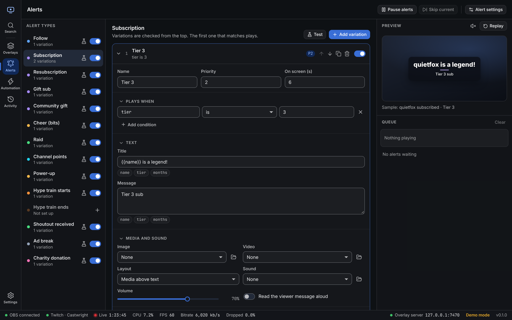

Alerts play inside the **Alerts** layer of any overlay. Design them here once, and every overlay with an Alerts layer uses them.

## Alert types

The left column lists every alert type. Use the switch to turn a type on or off, and the flask button to play a test. Test alerts never run automation, so a test raid won't shout out a made-up viewer. Types marked **Not set up** can be added with **+**.

## Variations

Each type has one or more **variations**: different looks for different situations, like a bigger alert for tier 3 subs or 1,000+ bits.

Castwright checks variations **from the top down** and plays the **first one that matches**. Put the most specific ones at the top with the arrows.

| Setting | What it does |
| --- | --- |
| **Plays when** | Conditions, for example `tier is 3` or `amount is at least 1000`. No conditions means it always matches. See [conditions](/reference/conditions/). |
| **Priority** | When alerts pile up, higher priority ones jump the queue. |
| **On screen** | How many seconds the alert stays. |
| **Title** and **Message** | Text with live values. Click a chip like `name` or `months` to insert it. See [templates](/reference/templates/). |
| **Media and sound** | An image or video, its layout, a sound and its volume. |
| **Read the viewer message aloud** | Text to speech for the message, using the voices built into your system. |
| **Look** | Title and message fonts, sizes and colours. Pick a style (Comic, Neon, Pixel and more) to give the alert its own card, then change its shape, fill, pattern, border, stripe, shadow and tilt. **Back to classic card** undoes it. |
| **Animation** | How the alert comes in and goes out. |
| **Also run an action** | Starts an [automation](/guide/automation/) action when the alert plays, for example to switch scene on a raid. |

The **Preview** on the right shows the selected variation with a sample event. Click **Replay** to see the full animation.

## Queue

Alerts play one at a time. The queue on the right shows what's playing and waiting.

- **Pause alerts** holds new alerts until you resume. Handy during a cutscene.
- **Skip current** ends the playing alert early.
- Remove a waiting alert with ×, or **Clear** them all.

## Alert settings

| Setting | Default | |
| --- | --- | --- |
| Gap between alerts | 0.8 s | Pause between one alert and the next. |
| Combine community gifts | On | One alert for "gifted 10 subs" instead of ten. |
| Blocked words | none | Hides the viewer message, and skips reading it aloud, when it contains one of these. The alert still plays. |
| Hide links | On | Replaces web addresses in messages with `[link]`. |
| Minimum bits | 0 | Smaller cheers don't get an alert. |
| Minimum raid viewers | 0 | Smaller raids don't get an alert. |
| Longest queue | 50 | Beyond this, the oldest low-priority alerts are dropped. |

## Sound in OBS

Alert sounds come out of the Browser Source in OBS. Tick **Control audio via OBS** in its properties so you can set its volume in the OBS mixer. See [troubleshooting](/guide/troubleshooting/#alerts-play-but-theres-no-sound).

:::caution
Text to speech relies on the speech voices available to OBS's built-in browser, which differ by system and OBS version. Test it with the flask button before relying on it live.
:::
