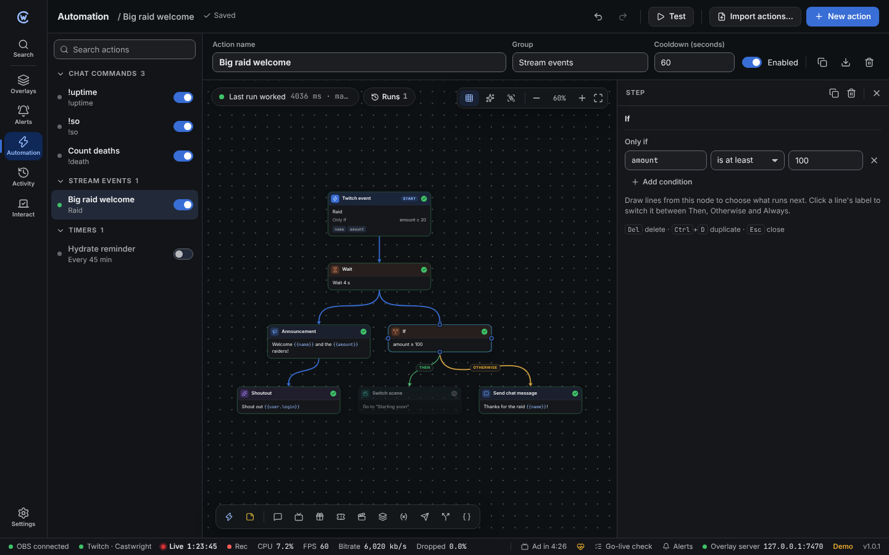
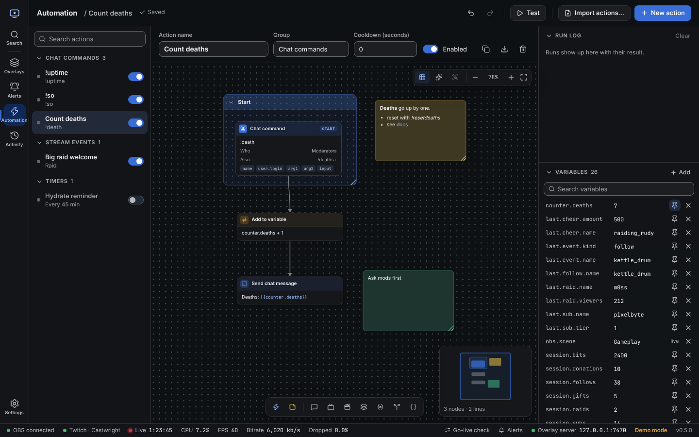
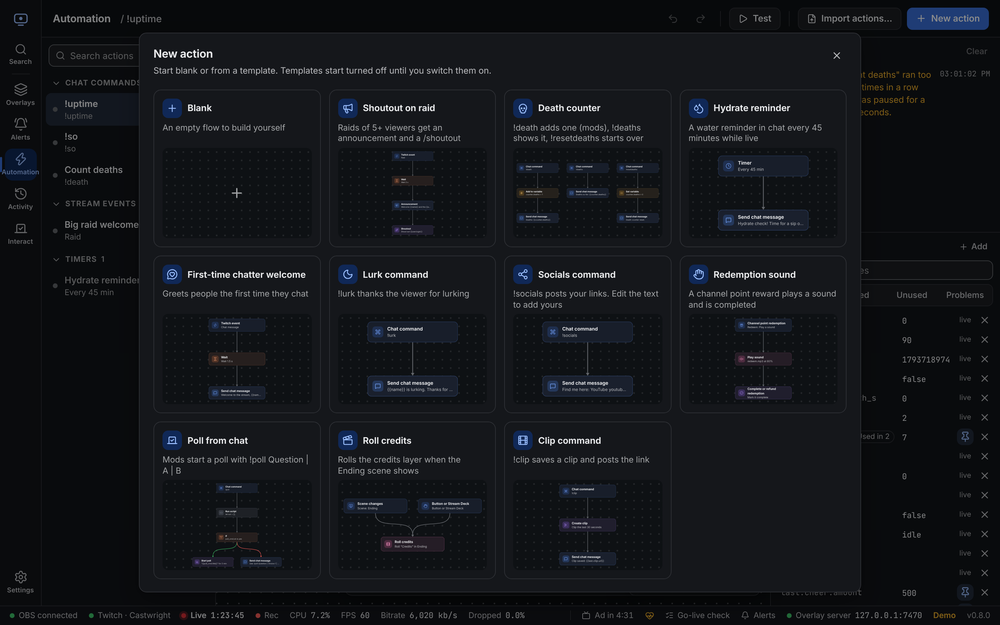
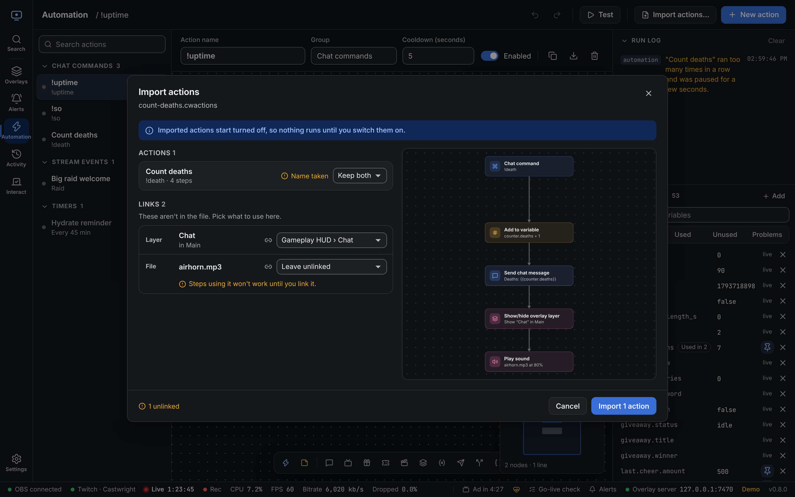
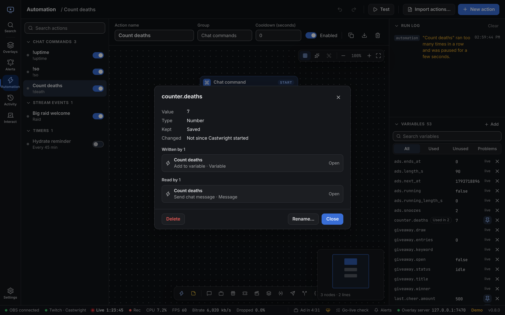

An **action** is a set of steps, joined by lines, that runs when one of its triggers fires. Use actions for chat commands, timed messages, raid welcomes, counters, scene switches and much more.

## The page

- **Left**: your actions, in folding sections (Chat commands, Stream events, Timers, Buttons and Stream Deck, plus your own groups). Search opens the sections that match.
- **Middle**: the selected action as a **flow**. Triggers are the blue **Start** nodes; steps are the other nodes. Lines show what runs next.
- **Right**: the run log and every variable. Fold either one, or drag the divider between them.

Drag the dividers to resize any column.

## Working in the flow

Nodes can sit anywhere. Lines can go from any side of a node to any side of another, and many lines can leave or arrive at the same side.

- **Move a node**: drag it. With **Snap** on it lines up with the grid; hold <kbd>Alt</kbd> to place it freely.
- **Drag past the edge**: while you drag a node, a line or a selection box, hold the pointer near the edge of the canvas and the view scrolls. The closer to the edge, the faster. <kbd>Esc</kbd> stops.
- **Connect two nodes**: hover a node, drag from one of the dots on its sides and drop on another node.
- **Add a step**: double-click empty space, use the bar at the bottom (with a node selected, the new step goes under it and is connected), or drag a line from a dot and let go on empty space.
- **Edit**: click a node. Its settings open beside the flow.
- **Lines from an If**: the first is **Then**, the second **Otherwise**. Click the label on a line to switch between Then, Otherwise and **Always**.
- **Select several**: <kbd>Shift</kbd> or <kbd>Ctrl</kbd> + click, or <kbd>Shift</kbd> + drag a box. Dragging one moves them all.
- **Move around**: drag empty space, scroll, or use the overview in the corner. <kbd>Ctrl</kbd> + scroll zooms where the pointer is. The corner buttons zoom and fit the whole flow.
- **Tidy up** lines everything up neatly: triggers on top, If branches side by side. One undo brings your layout back.
- **Test** runs the action now. Each node it reached shows a tick, an error, or a dash if it was skipped.

A dashed node with **Not connected** can't run because no trigger leads to it. The header counts these warnings. Notes and frames never get this warning.

| Keys | Does |
| --- | --- |
| <kbd>Delete</kbd> | Remove the selected nodes, notes, frames or line |
| <kbd>Ctrl</kbd> + <kbd>D</kbd> | Duplicate the selection, with the lines between its nodes |
| <kbd>Ctrl</kbd> + <kbd>X</kbd> / <kbd>C</kbd> / <kbd>V</kbd> | Cut, copy, paste where the pointer is |
| <kbd>Ctrl</kbd> + <kbd>A</kbd> | Select every node, note and frame |
| <kbd>Ctrl</kbd> + <kbd>G</kbd> | Put the selection in a frame |
| <kbd>Ctrl</kbd> + <kbd>Shift</kbd> + <kbd>G</kbd> | Remove the selected frame (or the frame of the selected nodes), keeping what's inside |
| <kbd>Shift</kbd> + double-click | Add a note there |
| Arrow keys | Nudge the selection (<kbd>Shift</kbd> for a grid step) |
| <kbd>Enter</kbd> / <kbd>Esc</kbd> | Open or close the settings (on a note: edit it, on a frame: rename it); <kbd>Esc</kbd> again clears the selection |
| <kbd>Esc</kbd> while dragging | Stop where you are (a line being drawn is dropped) |
| <kbd>Esc</kbd> on a past run | Back to the latest run |
| <kbd>F</kbd> | Fit the whole flow in view |
| <kbd>Space</kbd> + drag | Move around (so does the middle mouse button) |
| <kbd>Ctrl</kbd> + <kbd>Z</kbd> / <kbd>Ctrl</kbd> + <kbd>Shift</kbd> + <kbd>Z</kbd> | Undo and redo |

## Notes and frames

Notes and frames help you and others read a flow. Runs ignore them.

**Sticky notes**

- **Add**: **Note** in the bottom bar, or <kbd>Shift</kbd> + double-click empty space.
- **Write**: double-click the note. Click outside or press <kbd>Esc</kbd> when done.
- **Format**: `**bold**`, `*italics*`, `[link text](https://…)`, and lines starting with `- ` or `1. ` for lists.
- **Colour**: select the note and pick a dot above it.
- **Resize**: drag the bottom-right corner.

**Frames**

A frame is a labelled box behind a group of nodes.

- **Make one**: select nodes (and notes if you like), then **Group** at the top or <kbd>Ctrl</kbd> + <kbd>G</kbd>.
- **Move it**: drag the title bar. Everything inside moves with it.
- **Add or remove nodes**: drop a node over the frame and it joins. Drag it out and it leaves.
- **Rename**: double-click the title. **Colour**: select the frame and pick a dot.
- **Resize**: drag the bottom-right corner. Nodes now inside join, nodes now outside leave.
- **Collapse**: the arrow in the title bar folds the frame down to its title. Its nodes are hidden, and lines to them end at the frame instead. They still run as normal.
- **Ungroup**: <kbd>Ctrl</kbd> + <kbd>Shift</kbd> + <kbd>G</kbd> removes the frame and keeps its nodes. Deleting a frame also keeps its nodes.

Copying or duplicating a frame copies everything inside it. **Tidy up** keeps each frame's nodes together and moves the frame as one block. Notes outside frames stay where they are.

Notes and frames are saved with the action and included when you [share it](#share-actions).

## Watch a run

While an action runs (from **Test** or a real trigger), the flow follows along:

- The node that's running has a glowing outline. A **Wait** stays like that until it's done.
- Each line the run takes lights up in the accent colour and stays lit.
- When it's done, every node shows its result.

**Runs** next to the result at the top left lists the last 10 runs of the action. Pick one to see what it did:

- The lines it took are lit and each node shows its result.
- The arrows step through the run one node at a time. The current node has an outline.
- **Live** or <kbd>Esc</kbd> goes back to the latest run.

The run list is kept until Castwright closes. With reduced motion on, nothing pulses; the running node just has a steady outline.

## Start an action

Click **New action** and pick a [template](#templates) or start blank. Every change saves on its own.

| Setting | What it does |
| --- | --- |
| **Group** | Sorts actions in the list, for example "Chat commands". |
| **Cooldown** | Shortest time between two runs. 0 means no limit. |
| **Enabled** | Off stops all triggers. **Test** still works. |

## Triggers

An action can have several triggers. Each starts the run from its own node, so different triggers can lead to different steps.

| Trigger | Fires when |
| --- | --- |
| **Chat command** | Someone types the command, like `!so @name`. Set other names it answers to, **who can use it** and a **per-viewer cooldown** (moderators and you skip it). |
| **Twitch event** | A follow, sub, raid, redemption and so on happens, optionally only when [conditions](/reference/conditions/) match. **Chat message** fires for every message; add a condition such as *First message ever*. |
| **Timer** | Every few minutes. Can be limited to while you're live and to when chat has been active. Runs at most every 10 seconds. |
| **Stream goes live** / **Stream ends** | Your stream starts or stops. |
| **Scene changes** | OBS switches to a scene (or any scene). |
| **Ad starting soon** / **Ad break begins** / **Ad break ends** | Some minutes before an ad, or when one starts or ends. See [Ads and Discord](/guide/ads-discord/#automation). |
| **Giveaway opens** / **closes** / **winner drawn**, **Player picked from queue** | Giveaway and queue moments. See [Giveaways and queue](/guide/giveaways-queue/#automation). |
| **Button or Stream Deck** | Only runs when you click **Test** or call its [run link](/guide/stream-deck/). **Test** starts here when the action has one. |

Messages from your bot and from Castwright itself never trigger actions, so actions can't set each other off in a loop. Test events from the Alerts page don't run actions either; use **Test** to try one.

## Steps

Steps run along the lines from the trigger that fired. Add one from the flow and pick from:

| Group | Steps |
| --- | --- |
| **Chat** | Send chat message (as you or the bot, optionally as a reply), announcement |
| **Twitch** | Shoutout, create clip, stream marker, run ad, snooze ad, set title and category, time out user |
| **Giveaways & queue** | Open, close and draw a giveaway; open or close the queue, next players, clear |
| **OBS** | Switch scene, show/hide source, mute/unmute, recording, save replay |
| **Overlays & alerts** | Show/hide overlay layer, roll credits, play a custom alert, play sound |
| **Variables** | Set variable, add to variable |
| **Discord** | Post to Discord |
| **Logic** | If, wait, run another action, stop |
| **Advanced** | Web request, run a [script](/reference/scripting/), write to the log |

Text fields accept live values in `{{double braces}}`. In web request addresses, add `| url` to keep chat input from breaking the link, like `{{input | url}}`. The chips under each field show what's available, such as `name`, `arg1` (the first word after a command) and `input` (everything after it). See [templates](/reference/templates/).

An **If** follows its **Then** lines when the conditions match and its **Otherwise** lines when they don't. **Always** lines are followed either way. How runs move through the lines is explained in the [steps reference](/reference/automation-steps/#how-a-run-moves).

Every step and option is described in the [automation steps reference](/reference/automation-steps/).

## Examples

**`!so` shoutout**: trigger *Chat command* `so`, who can use it *Moderators and the streamer*; step *Shoutout* with `{{arg1}}`.

**Deaths counter**: trigger *Chat command* `death`; steps *Add to variable* `counter.deaths` by 1, connected to *Send chat message* `Deaths: {{counter.deaths}}`. Show it on stream with a **Counter** layer.

**Raid welcome**: trigger *Twitch event* `Raid` when `amount is at least 10`; steps *Switch scene* to "Raid", *Wait* 15 seconds, *Switch scene* back.

## Templates

**New action** opens the template picker. Each card shows what the template does and a small preview of its flow.

| Template | What it does |
| --- | --- |
| **Shoutout on raid** | Raids of 5 or more viewers get an announcement and a `/shoutout`. Change the number in the trigger. |
| **Death counter** | `!death` adds one (mods), `!deaths` shows the total, `!resetdeaths` starts over (mods). Creates `counter.deaths`. |
| **Hydrate reminder** | A water reminder in chat every 45 minutes while live. |
| **First-time chatter welcome** | Greets people the first time they chat. Castwright counts from when it first saw them, so everyone is new on a fresh install. |
| **Lurk command** | `!lurk` thanks the viewer. |
| **Socials command** | `!socials` posts your links. Edit the message to add yours. |
| **Redemption sound** | A reward named "Play a sound" plays a sound, then completes the redemption. Pick your own reward in the trigger. |
| **Poll from chat** | Mods type `!poll Question \| Choice 1 \| Choice 2` (up to 5 choices). |
| **Roll credits** | Rolls a [credits layer](/guide/overlay-editor/#credits-layer) when OBS switches to a scene named "Ending", or from a button. |
| **Clip command** | `!clip` saves a clip and posts the link. |

A template opens in the same window as an import, so you can link the sound or layer it uses. Templates start turned **off**. Switch on **Turn on now** to run it right away; this works once everything is linked.

## Share actions

Actions export to a `.cwactions` file you can send to someone or keep as a copy.

**Export**

- One action: the export button in the action header, or right-click it in the list and pick **Export…**.
- Several: <kbd>Ctrl</kbd> + click or <kbd>Shift</kbd> + click them in the list, then **Export…** in the bar below it.
- A whole section: hover its name and pick **⋯ → Export group…**.

**Import**

Click **Import actions…** at the top, or drop a `.cwactions` file on the Automation page. Nothing changes until you confirm. You see:

- Each action with its triggers, step count and a preview of its flow.
- **Name taken**: keep both (the new one gets "(2)"), replace yours, or skip it.
- **Links**: layers, actions and files the steps use that aren't in the file. Castwright picks one with the same name when it can. Pick another, or leave it unlinked. Unlinked steps won't work until you set them.
- **New variables** the actions use, with their starting value.

Imported actions start turned **off**, so nothing runs by surprise. Check them, then switch them on.

**What's in the file**

- The actions and their flows, with their notes and frames.
- Names and starting values of the variables they use. Counters start at 0.
- Names of the layers, other actions and files the steps point at. The files themselves aren't included; share those separately.

Variables whose name has `secret`, `token`, `password`, `key`, `auth` or `webhook` as a word (like `api_key` or `discord.webhook`) never have their value included. Text in steps, like messages and web addresses, is included as it is, so check for private links before you share.

See [`.cwactions` files](/reference/files/#cwactions-files) for the format.

## Run log and variables

The right side shows each run with its result and any errors, plus every [variable](/reference/variables/). Edit a value inline, delete it, or add one. The pin keeps a variable after Castwright restarts.

## Variable inspector

The Variables list shows where each variable is used.

- **Used in 3**: three places set or show it, like steps, overlay layers and alerts.
- A warning icon marks a likely mistake. See below.
- Filter the list with **All**, **Used**, **Unused** and **Problems**.

Click a variable's name to open its details:

- Its value, its type, whether it's saved or live, and when it last changed.
- **Written by**: steps that set it, or the part of Castwright that keeps it up to date, like Twitch or OBS.
- **Read by**: steps, conditions, overlay layers and alert texts that use it.

Click any place in the lists to go there. A step opens with its node selected, a layer opens in the overlay editor, and an alert opens on the Alerts page.

### Problems

| Problem | What it means | What to do |
| --- | --- | --- |
| Nothing sets it | Something reads the variable, but no step sets it and it has no value. Often a typo. | Use **Change to…** when a close name is suggested. |
| Saved, but nothing uses it | A saved variable that nothing reads. | Delete it, unless a custom widget or the local API uses it. Those aren't checked. |

### Rename a variable

1. Open the variable's details and click **Rename…**.
2. Type the new name. The preview lists every change.
3. Click **Rename**.

Every template, condition, layer setting and script call (`get`, `set`, `save`) with the old name changes, and the value moves to the new name. Names that only look alike, like `counter.deaths2`, stay as they are.

A backup is made first. Click **Undo** on the message that follows, or restore the backup from **Settings → Backups and data**.

Built-in variables, like `session.subs` and `obs.scene`, can't be renamed.

### Variables in a step

In the step inspector, fields that use variables list them under the field. Hover one to see its value and how many places use it. Click it to open its details.
