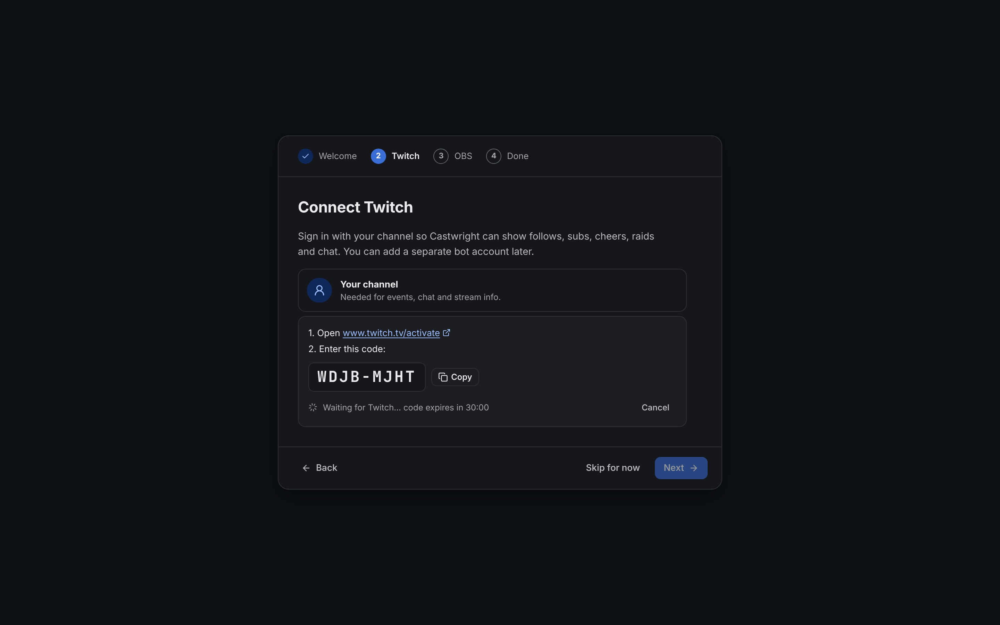

The first time Castwright opens, a short setup guide runs. It takes about two minutes. You can skip any step and finish it later in **Settings**.

## 1. Pick a look

Choose **Match system**, **Dark**, **Light** or **High contrast**. You can make your own theme later in [Settings](/guide/settings/#themes).

## 2. Sign in to Twitch

1. Click **Sign in with Twitch**. Your browser opens `twitch.tv/activate`.
2. Type the code Castwright shows, or click **Copy** and paste it.
3. Approve the permissions. Castwright notices on its own, then click **Next**.

The code is valid for 30 minutes. Castwright never sees your Twitch password.

:::note
Some builds ask for a **Twitch client ID** first. See [Use your own Twitch app](/guide/settings/#use-your-own-twitch-app).
:::

## 3. Connect OBS

In OBS:

1. Open **Tools → WebSocket Server Settings**.
2. Tick **Enable WebSocket server**.
3. Click **Show Connect Info** and copy the **Server Password**.

In Castwright, paste the password and click **Save and connect**. The address is `127.0.0.1` and the port `4455` when OBS runs on the same computer.

Use **Test** to check the details without saving.

## 4. Done

Click **Open Castwright**. Next, try [your first overlay](/guide/quick-start/).

To run the guide again, go to **Settings → General → Run setup**.
