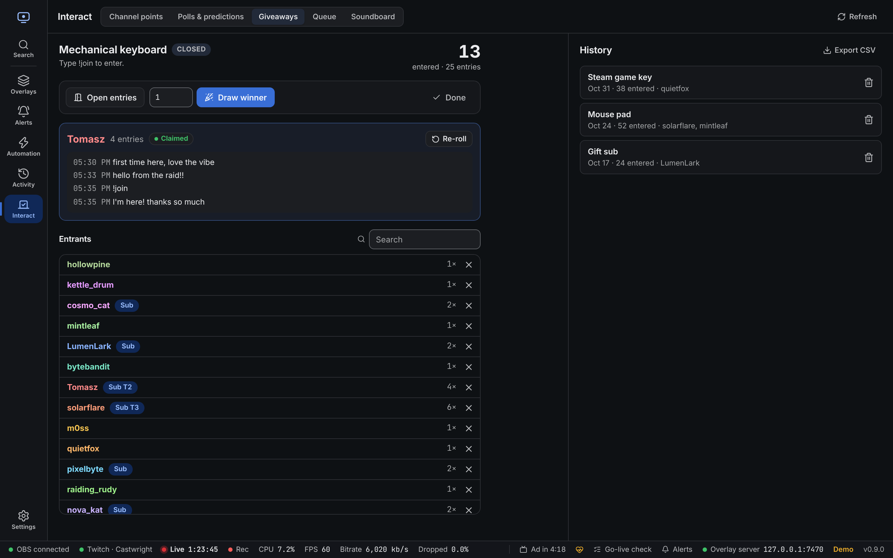
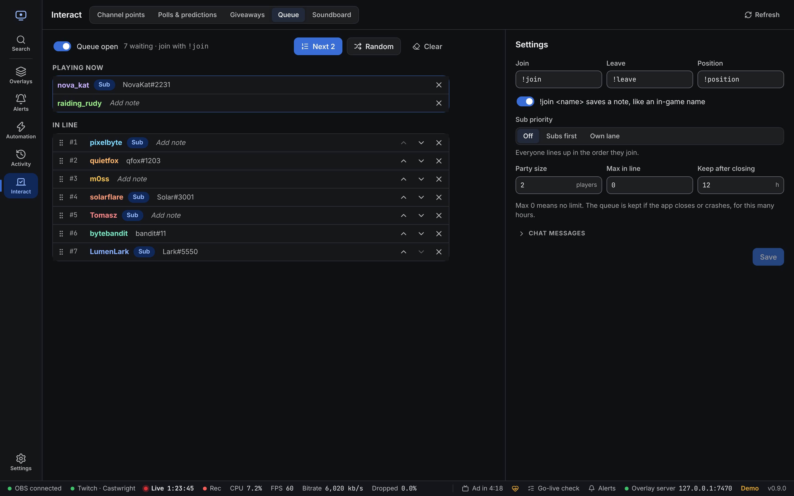
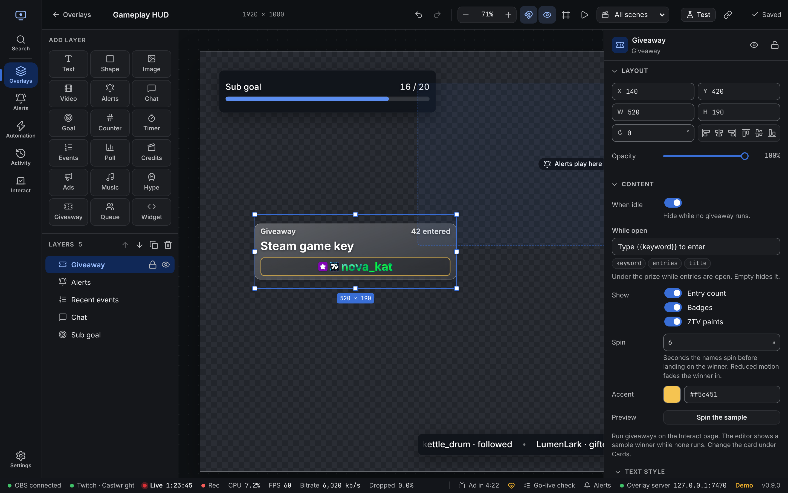

Both live on the **Interact** page, in the **Giveaways** and **Queue** tabs.

## Giveaways

### Set one up

| Field | What it does |
| --- | --- |
| **Prize** | Shown in chat and on the overlay. Up to 80 characters. |
| **Chat keyword** | The word viewers type, like `!join`. Empty turns chat entries off. |
| **Channel point reward** | One of the rewards made in Castwright. Entries are completed; refused ones are refunded. |
| **Who can enter** | Everyone, followers or subs. Followers can need a minimum follow age in days. |
| **Leave out** | The broadcaster, mods, or bots (your bot account and common ones like Nightbot). |
| **Subs get** | Extra entries for subs, like 2×. Turn on tier bonus to give tier 2 and 3 subs double and triple that. |
| **Each redemption adds more entries** | Only with a reward. Off: one entry per person. |
| **Close after** / **Close at** | Stop entries after some minutes or people. 0 is off. |
| **Time to claim** | Seconds a winner has to chat. 0 is off. |

Your last setup is kept for next time.

### Run it

1. Click **Open giveaway**. Entries show up in the list as they come in.
2. Search the list, or remove someone with **×**.
3. Click **Close entries**, or just **Draw**. Drawing closes entries first.
4. Pick how many winners to draw. More entries means a better chance.
5. Each winner's recent chat shows under their name, so you can see if they're around.
6. When the claim time runs out, the winner turns red. Click **Re-roll** to pick someone else, or **Mark claimed** if they showed up late.
7. Click **Done** to save it to history.

Winners who chat before the time runs out are marked claimed on their own. Each person can only win once per giveaway.

:::note[Fair draws]
Winners are picked with a secure random number, weighted by entries.
:::

### Chat messages

Under **Chat messages**, turn each message on or off and change its text:

| Message | Sent when |
| --- | --- |
| **Opened** | The giveaway opens. `{{how}}` says how to enter. |
| **Closed** | Entries stop. |
| **Winner** | Someone wins. |
| **Re-roll** | A new winner replaces one. `{{previous}}` is who missed out. |

All messages can use `{{title}}`, `{{keyword}}`, `{{entries}}`, `{{winner}}` and `{{claim_s}}`. They're sent from your bot account when one is signed in.

### History

Finished giveaways are listed on the right with the date, how many entered and who won. **Export CSV** saves the list as a spreadsheet file.

## Viewer queue

For playing with viewers. Turn on **Queue open**, then viewers type:

| Command | What it does |
| --- | --- |
| `!join` | Joins the line. `!join Kat#1234` also saves a note, like an in-game name. |
| `!leave` | Leaves the line. |
| `!position` | Replies with their place in line. |

Change the words under **Settings**. Each must be different.

### Run it

- **Next** pulls in the next players, as many as the party size. The last group is done.
- **Random** pulls in players at random.
- Drag people to reorder, or use the arrows.
- Click a note to change it. **×** removes someone; **Clear** removes everyone.

### Settings

| Setting | What it does |
| --- | --- |
| **Sub priority** | **Subs first** puts subs ahead of everyone else. **Own lane** gives subs their own line; picks take turns between the two. |
| **Party size** | Players **Next** pulls in. |
| **Max in line** | Most people waiting. 0 is no limit. Viewers get a reply when it's full. |
| **Keep after closing** | Hours the queue is kept if Castwright closes or crashes. 0 forgets it. |
| **Chat messages** | Joined, left, you're up and position replies. Each can be turned off. |

### Keyword clash

If the queue's join word is the same as an open giveaway's keyword, a warning shows. While the giveaway is open, that word enters the giveaway, not the queue. Use different words, like `!join` and `!play`.

## Chat limits

Castwright never replies to its own messages or to bots. When many people join the queue at once, it answers them together in one message, like "B, C and D joined the queue (#2–4)". Replies stay under 10 messages in 30 seconds, so chat isn't flooded. Giveaway announcements always go out.

## Overlay layers

| Layer | Shows |
| --- | --- |
| **Giveaway** | The prize, how to enter and the entry count. On a draw, names spin and land on the winner, with their 7TV paint and badges. With reduced motion, the winner fades in. Hidden while no giveaway runs (turn off **Hide when idle** to keep it). |
| **Viewer queue** | **Playing now** and the next people in line, with places and notes. Hidden while the queue is empty. **First in line** puts the line at the top or the bottom. |

Both use [style presets](/guide/overlay-editor/#styles) under **Cards**. In the editor, they show a sample. **Spin the sample** plays the spin. Custom CSS selectors are in the [styling reference](/reference/styling/#giveaway).

## Automation

| Trigger | Gives |
| --- | --- |
| **Giveaway opens** / **Giveaway closes** | `{{title}}`, `{{entries}}` |
| **Giveaway winner drawn** | `{{winner}}`, `{{title}}`, `{{entries}}`. Runs once per winner, re-rolls too. |
| **Player picked from queue** | `{{player}}`, `{{note}}`, `{{players}}`. Runs once per player. |

Steps: **Open giveaway**, **Close giveaway**, **Draw winner**, **Open or close queue**, **Next in queue** and **Clear queue**. See the [steps reference](/reference/automation-steps/#giveaways-and-queue).

Variables like `{{giveaway.entries}}`, `{{giveaway.winner}}`, `{{queue.size}}` and `{{queue.next}}` work anywhere. See [variables](/reference/variables/#giveaways).
