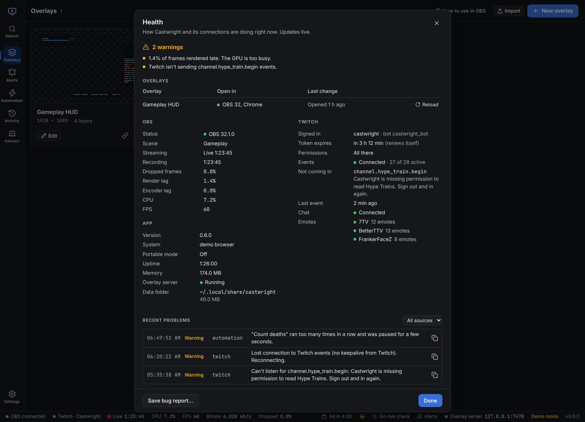
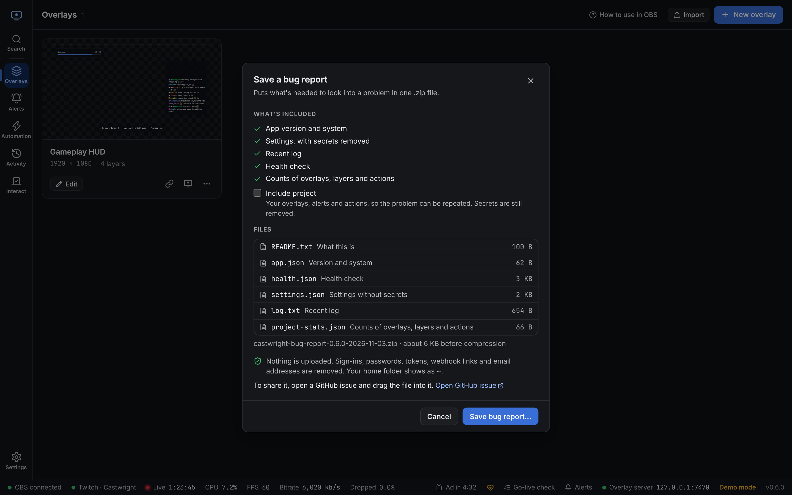

**Health** shows how Castwright and its connections are doing right now. It updates live while it's open.

Open it from:

- the heart icon in the status bar
- the command palette (<kbd>Ctrl</kbd> + <kbd>K</kbd>, type "health")
- **Settings → About → Health**

## The status bar icon

| Colour | Means |
| --- | --- |
| Grey | All good |
| Yellow | At least one warning |
| Red | At least one problem |

Hover over it to see what's wrong.

## What it shows

| Section | Shows |
| --- | --- |
| **Overlays** | Where each overlay is open right now (like "OBS 32" or "Chrome"), when it last opened or closed, and a **Reload** button |
| **OBS** | Connection, version, scene, streaming and recording, dropped frames, render lag, encoder lag, CPU and FPS |
| **Twitch** | Who's signed in, when the token expires, missing permissions, Twitch events (how many are active, which failed and why), the last event, chat and 7TV, BetterTTV and FrankerFaceZ emotes |
| **App** | Version, system, portable mode, uptime, memory use, the overlay server and the data folder with its size |
| **Recent problems** | The last 50 warnings and errors. Filter by source, and copy one with the copy button. |

Twitch tokens renew themselves, so an expiry time is only for information.

Emotes only show once a chat panel or chat layer in the app window has loaded them.

### What counts as a problem

| Problem (red) | Warning (yellow) |
| --- | --- |
| The overlay server isn't running | OBS can't be reached |
| Twitch events can't connect | 1% or more of frames dropped, rendered late or skipped by the encoder (5% or more is a problem) |
| | OBS uses 90% CPU or more |
| | Some Twitch event types or permissions are missing |
| | An emote provider isn't loading |
| | An error in the last 5 minutes |

## Save a bug report

**Save bug report…** in Health or in **Settings → About** makes one `.zip` file with what's needed to look into a problem.

It holds:

| File | Holds |
| --- | --- |
| `README.txt` | What the file is and when it was made |
| `app.json` | Version, system and folders |
| `health.json` | Everything in Health |
| `settings.json` | Your settings, with secrets removed |
| `log.txt` | The last 2000 log lines |
| `project-stats.json` | How many overlays, layers, actions and files you have. No names or content. |
| `project.json` | Only if you tick **Include project**. Your overlays, alerts and actions. |
| `crash.json` | Only after a crash. What happened just before. |

The dialog lists every file and its size before you save.

### What's removed

- Twitch sign-ins, the OBS password and the overlay link secret
- Anything that looks like a token, password, API key or client secret
- Webhook links (Discord, Slack and others)
- Email addresses
- Your home folder, shown as `~`

Removed text shows as `[removed]`.

### Sharing it

Nothing is uploaded. To share the report:

1. Click **Open GitHub issue**. The version is already in the title.
2. Describe what happened.
3. Drag the `.zip` into the issue.

## After a crash

If Castwright closed because of an error, it says so the next time it starts and offers to save a bug report. The crash details go in the report as `crash.json`.

Log files and the crash file are in the `logs` folder. See [Files and data](/reference/files/#logs).
