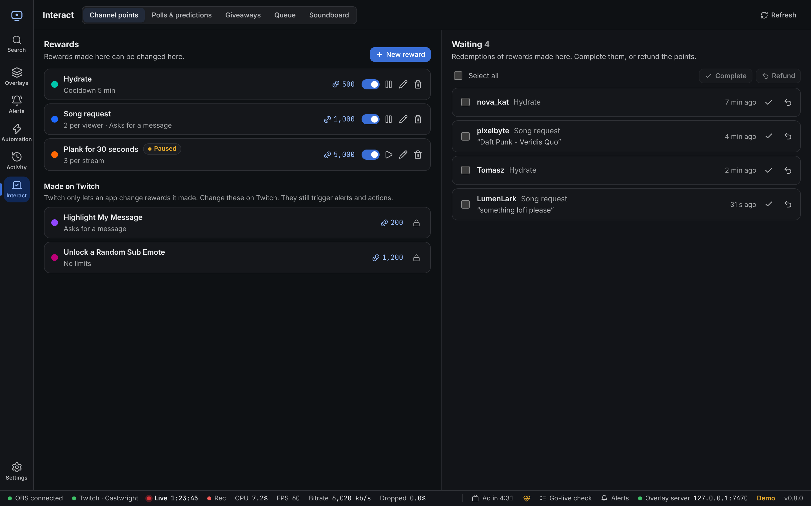
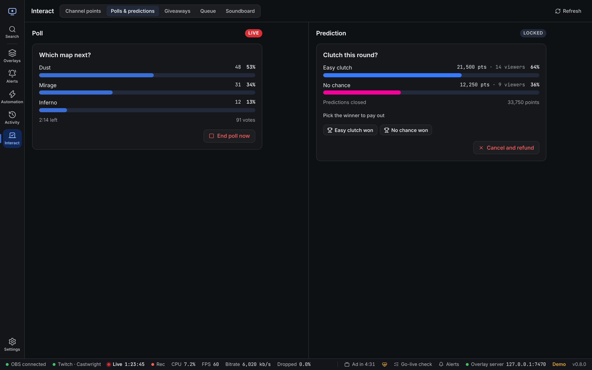
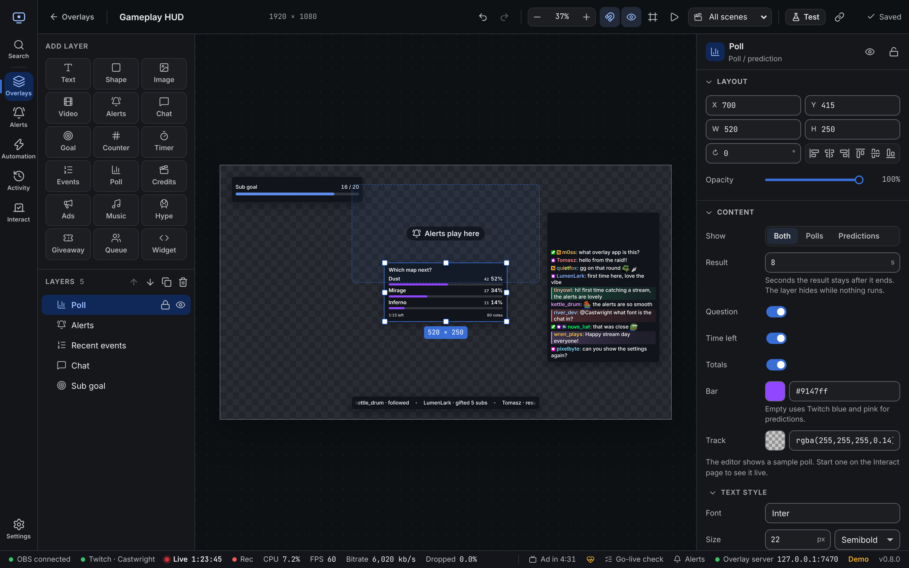

Open **Interact** in the left bar, or press **Ctrl + 5** (**⌘ + 5** on Mac). It has five tabs: **Channel points**, **Polls & predictions**, **[Soundboard](/guide/soundboard/)**, **Giveaways** and **Queue**. Giveaways and the queue have their own page: [Giveaways and queue](/guide/giveaways-queue/).

:::note[Affiliate or Partner only]
Twitch only gives channel points, polls and predictions to Affiliates and Partners. On other channels the page says so, and everything else in Castwright works as usual. The soundboard works for everyone, signed in or not.
:::

## Channel points

### Rewards

Click **New reward** and fill in:

| Field | Notes |
| --- | --- |
| Title | Up to 45 characters. Each reward needs its own title. |
| Cost | Points, 1 or more |
| Description | Optional, up to 200 characters |
| Colour | Pick one or type a hex colour like `#9147FF` |
| Cooldown | Seconds between redemptions. 0 is off. Up to 7 days. |
| Max per stream / per viewer | 0 is no limit |
| Viewer types a message | Asks for text when redeeming |
| Skip the queue | Redemptions count as complete straight away |
| On | Off hides the reward from viewers |

Each reward row has a switch to turn it on or off, **Pause** (still visible, can't be redeemed), **Edit** and **Delete**.

**Made on Twitch:** Twitch only lets an app change rewards it made itself. Rewards you made on twitch.tv show with a lock and can't be edited here. They still play alerts and run actions.

### Redemption queue

**Waiting** lists redemptions of rewards made in Castwright. New ones appear as they come in.

- **✓** completes one, **↶** refunds its points.
- Tick several (or **Select all**), then **Complete** or **Refund**.

Rewards with **Skip the queue** never show up here.

## Polls and predictions

### Polls

1. Type the question (up to 60 characters).
2. Add 2 to 5 choices (up to 25 characters each).
3. Pick how long it runs.
4. Optional: **Extra votes for channel points** lets viewers buy more votes.
5. Click **Start poll**.

Results update live. **End poll now** stops it early and shows the result. Only one poll can run at a time.

### Predictions

1. Type the question (up to 45 characters) and 2 to 10 outcomes.
2. Pick how long viewers can predict, then **Start prediction**.
3. **Lock now** closes predicting early. Twitch locks it on its own when the time is up.
4. Click **… won** on the right outcome to pay out, or **Cancel and refund**.

## Show it on stream

Add a **Poll / prediction** layer in the [overlay editor](/guide/overlay-editor/). It shows the running poll or prediction with bars, the question, time left and totals.

- It hides while nothing runs, and shows the result for a few seconds after the end (**Result**, 8 s by default).
- **Show** picks polls, predictions or both. With both, the newest one wins.
- **Cards** styles each choice, with the same style presets as chat and event lists.
- Prediction bars use Twitch blue and pink unless you set a bar colour.
- The editor always shows a sample, so you can style it any time.

Class names for Custom CSS are in the [styling reference](/reference/styling/#poll--prediction).

## Automation

New triggers: **Channel point redemption** (one reward or any), **Poll starts**, **Poll ends**, **Prediction starts** and **Prediction ends**.

New steps under **Points & polls**: complete or refund the redemption, turn a reward on, off or pause it, change its cost, start or end a poll, start a prediction, and lock, resolve or cancel it.

Example: a "Skip song" reward that refunds when the queue is empty.

1. Trigger: **Channel point redemption**, reward *Skip song*.
2. Step: **If** `counter.songs` is 0.
3. Then: **Complete or refund redemption** set to *Refund the points*, and **Send chat message** "Nothing to skip, {{user}}!".

Details are in the [triggers and steps reference](/reference/automation-steps/#channel-points-polls-and-predictions).

## Signed in before?

These features need extra Twitch permissions. If you signed in before they were added, the Interact page and the [go-live check](/guide/go-live-check/) ask you to sign out and in again in **Settings → Twitch**. Until then, everything else keeps working.
