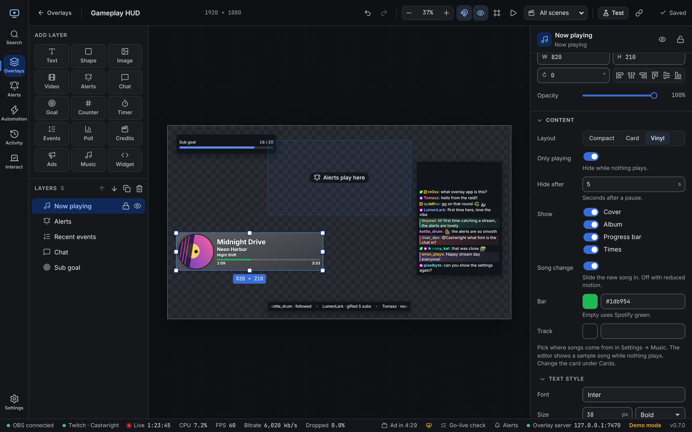
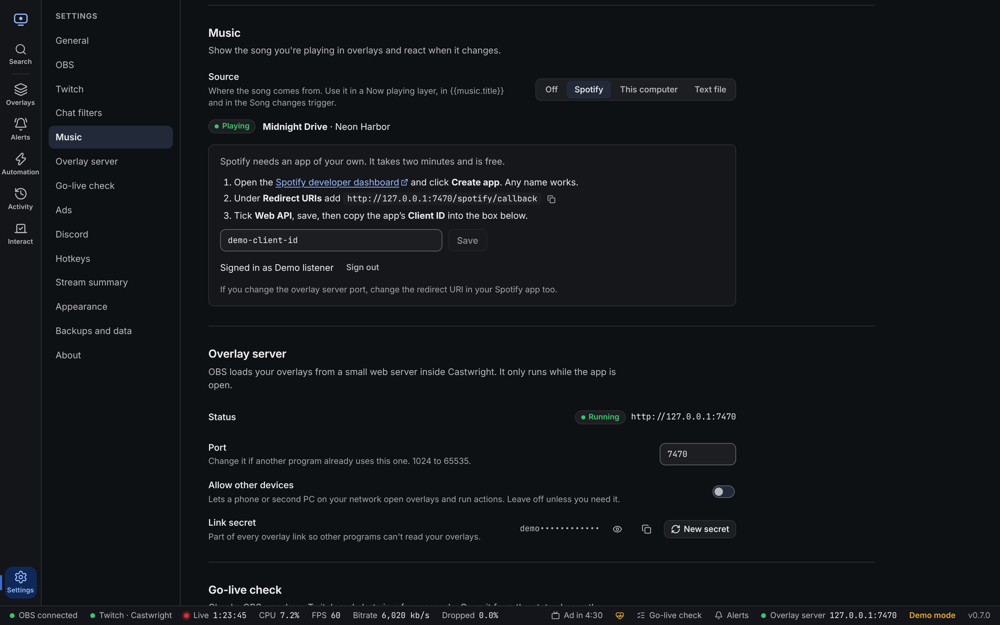

Castwright can read the song you're playing and show it in a **Now playing** layer, in text layers and in automation.

## Pick a source

Open **Settings → Music** and pick where songs come from.

| Source | Works with | Progress bar | Cover |
| --- | --- | --- | --- |
| **Spotify** | Your Spotify account, on any device | Yes | Yes |
| **This computer** | Any player in your system media controls: the Spotify app, browsers, VLC, foobar2000 and more. Windows and Linux. | Yes, if the player reports it | Yes |
| **Text file** | Tools that write the song to a file: Snip, Tuna for OBS, foobar2000, MusicBee and others | No | No |

When nothing shows the song, Castwright checks less often to save Spotify requests and battery.

### Spotify

Spotify only lets apps sign in with a Spotify app of their own. Making one takes two minutes and is free.

1. Open the [Spotify developer dashboard](https://developer.spotify.com/dashboard) and click **Create app**. Any name and description work.
2. Under **Redirect URIs**, add the address shown in Settings, for example `http://127.0.0.1:7470/spotify/callback`. It must match exactly.
3. Tick **Web API** and save.
4. Copy the app's **Client ID** into Settings and click **Save**.
5. Click **Sign in with Spotify** and allow access in your browser. The tab says when you can close it.

Castwright only asks to read what's playing. The sign-in stays in your system keychain and renews itself. It's never in backups or exports.

:::note
The redirect address uses the overlay server port. If you change the port in **Settings → Overlay server**, change the redirect URI in your Spotify app too.
:::

**Signing in fails.** Check that the redirect URI is exactly the one in Settings, with `127.0.0.1` (not `localhost`) and the same port. If you sign in with a different Spotify account than the one that made the app, add it under **User Management** in the app first.

### This computer

Reads whatever shows in your system media controls. When several players have a song, the one playing wins.

- **Windows** uses the system media controls, the same as the volume flyout.
- **Linux** uses MPRIS, which nearly every player supports.
- **macOS** isn't supported. Apple has no public way for apps to read the playing song. Use Spotify or a text file instead.

### Text file

Pick the file and how its text splits up. `{title}`, `{artist}` and `{album}` stand for the parts. `\n` is a new line.

| File says | Format |
| --- | --- |
| `Daft Punk - One More Time` | `{artist} - {title}` (the default) |
| `One More Time by Daft Punk` | `{title} by {artist}` |
| Title and artist on two lines | `{title}\n{artist}` |

Text that doesn't fit the format becomes the title. Castwright checks the file every second.

## Now playing layer

Add it from **Add layer → Music** in the [overlay editor](/guide/overlay-editor/). The editor shows a sample song while nothing plays.

| Setting | Default | |
| --- | --- | --- |
| **Layout** | Card | **Compact**: one line with a small cover. **Card**: cover, title, artist and progress. **Vinyl**: the cover spins like a record while the song plays. |
| **Only playing** | On | Hide while nothing plays. |
| **Hide after** | 5 s | Seconds after a pause before it hides. |
| **Show** | Cover, progress bar, times | Also the album. |
| **Song change** | On | Slides the new song in. |
| **Bar** and **Track** | Spotify green | Progress bar colours. |

Style the card under **Cards** with the same styles as chat and events. With *reduced motion* on, the record stays still and songs change without sliding. Its CSS classes are in the [styling reference](/reference/styling/#now-playing).

## Variables

These update while music plays and are never saved. Use them in text layers, like `{{music.title}} · {{music.artist}}`, and in actions.

| Variable | Value |
| --- | --- |
| `music.title` | Song title |
| `music.artist` | Artist, or several joined with commas |
| `music.album` | Album |
| `music.art_url` | Cover image link |
| `music.playing` | `true` while playing |
| `music.progress_ms` | Position in milliseconds |
| `music.duration_ms` | Length in milliseconds, `0` when unknown |

## Song changes trigger

Runs an action each time a new song starts. It gives `{{title}}`, `{{artist}}` and `{{album}}`.

Example: *Song changes* → *Send chat message* "Now playing: {{title}} by {{artist}}"

The song that's playing when Castwright starts doesn't count as a change.
