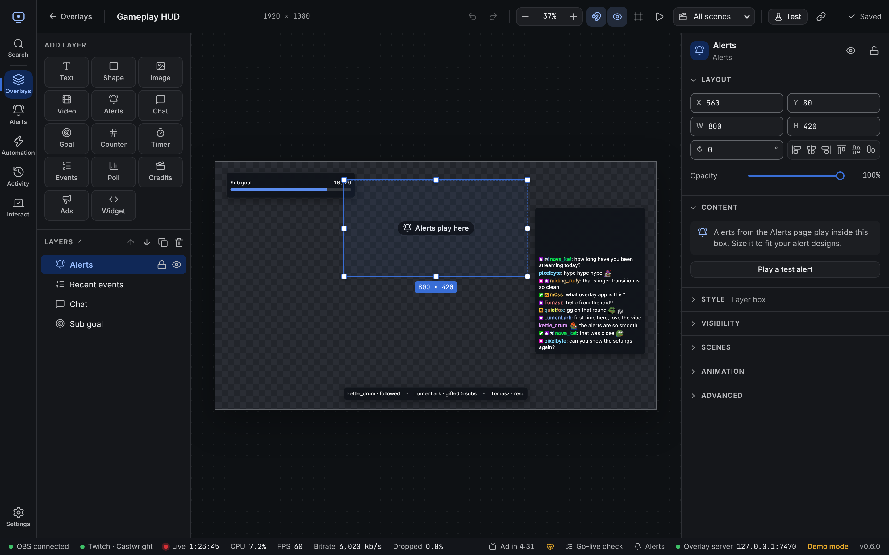
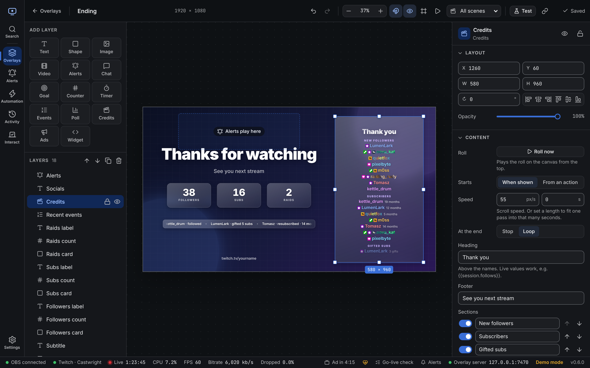
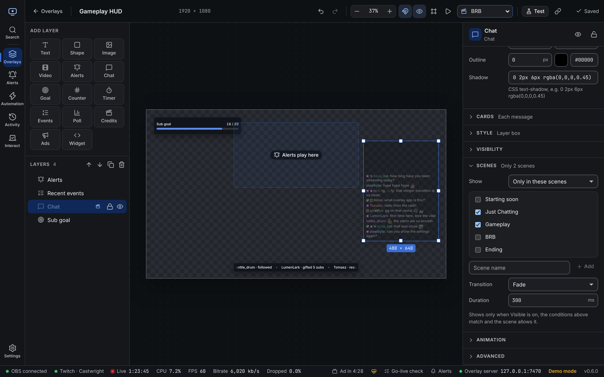

The editor shows your overlay exactly as OBS will, with live chat, events and variables.

- **Left**: add layers, and the **Layers** list (front first).
- **Middle**: the canvas.
- **Right**: settings for the selected layer, or for the overlay when nothing is selected. Drag the dividers to make either side wider; sections fold with a click on their title.

## Layer types

| Layer | What it shows |
| --- | --- |
| **Text** | Fixed text or live values like `{{last.follow.name}}`. See [templates](/reference/templates/). |
| **Shape** | Rectangle, ellipse or line. Good for backgrounds and frames. |
| **Image** | A logo, frame or picture from your project files. |
| **Video** | A looping video or animation. |
| **Alerts** | Where alerts play. Design them on the [Alerts](/guide/alerts/) page. |
| **Chat** | Live chat with Twitch and 7TV badges, 7TV name paints and 7TV, BetterTTV and FrankerFaceZ emotes. Can hide commands and bots. |
| **Goal** | A progress bar towards a target, such as follows or bits this stream. |
| **Counter** | A number from a [variable](/reference/variables/), like a death counter. |
| **Timer** | Countdown, stopwatch, clock or stream uptime. |
| **Events** | Recent follows, subs, cheers and more, as a list or ticker. |
| **Credits** | An end-of-stream roll of everyone who followed, subbed, gifted, cheered, raided or chatted. See [Credits layer](#credits-layer). |
| **Widget** | Your own HTML, CSS and JavaScript. See [custom widgets](/reference/custom-widgets/). |

## Styles

Pick a ready-made look under **Style** (the layer's box) or **Cards** (each chat message or event row): Clean, Comic, Speech bubble, Sticker, Riot, Neon, Pixel, Glass, Paper, Outline, Terminal and Candy. Every preview is drawn with your real layer.

After picking one, change any part of it:

| Group | What you can change |
| --- | --- |
| **Shape** | Square, rounded, pill, speech bubble with a tail, slanted, cut corners or pixel steps. Corner size, padding and lean. |
| **Fill** | One colour, a gradient or none, opacity and blur behind. |
| **Pattern** | Halftone dots, stripes, grid or paper grain on top of the fill. |
| **Border and stripe** | Width, colour and line (solid, dashed, double or thick ink), plus a coloured stripe on one side. |
| **Shadow** | Soft, hard offset (comic), glow, layered or your own. |

**Cards** also has: lean in turn (every other message tilts the other way, like stickers), a wash of each chatter's name colour, card around the whole message or just the words, and the gap between cards.

## Moving and sizing

- Drag a layer to move it, and the handles to resize. Hold **Shift** to keep its shape.
- Layers snap to the canvas edges, its centre and other layers. Hold **Ctrl** (**⌘** on Mac) to place freely, or turn snapping off in the top bar.
- **Alt**-click picks the layer underneath.
- Type exact numbers under **Layout**: position, size, rotation and opacity. The align buttons line a layer up with the canvas.

## Layer settings

Each layer has these sections on the right:

| Section | What's in it |
| --- | --- |
| **Content** | What the layer shows: text and font, image, chat options, goal target and so on. |
| **Style** | Background, border, corners, padding, shadow and backdrop blur. |
| **Visibility** | **Only show when**: rules that hide the layer unless they match, for example `stream.live is true`. See [conditions](/reference/conditions/). |
| **Scenes** | Which OBS scenes show the layer. See [Scenes](#scenes). |
| **Animation** | How the layer enters, leaves and moves while shown. Click the play button next to each to preview it. |
| **Advanced** | Custom CSS for the layer, and its ID for automation. The list under the CSS box shows which classes this layer has; click one to insert a rule. See [Custom CSS](/reference/styling/). |

Hide a layer with the eye in the Layers list. The **Show/hide overlay layer** automation step can show it at certain moments, like after a raid.

## Credits layer

A movie-style roll of the people who made this stream. Names come from the live stream, or the last one if you're offline.

**Sections**: new followers, subscribers (new and resubs, with months), gifted subs (with counts), cheers (with bits), raids (with viewers), moderators and VIPs who chatted, and top chatters (with message counts). Turn each on or off, rename it, or move it up and down. Empty sections are skipped.

| Setting | What it does |
| --- | --- |
| **Starts** | **When shown**: rolls as soon as the layer appears. **From an action**: stays empty until the **Roll credits** step runs. |
| **Speed** | Pixels per second. Or set **Fit to seconds** to make one pass take that long. |
| **At the end** | **Stop** keeps the last names on screen. **Loop** starts again from the bottom. |
| **Heading** and **Footer** | Text above and below the names. Live values work, like `{{session.follows}}`. |
| **Names** | **Plain** uses the name text style. **Like chat** adds chat colours and badges (for people who chatted recently) and 7TV paints. |
| **Columns**, **Fade edges**, **Amounts** | Names in 1 or 2 columns, a soft fade at the top and bottom, and months, gifts, bits and so on next to names. |

**Roll now** plays it on the canvas. With no stream yet, the editor shows sample names.

With *reduced motion* turned on in the system or browser, the roll shows still pages instead of scrolling. **Page time** sets how long each page stays.

Style the names, section titles and heading under **Content**, and a card around each section under **Section cards**. The **Ending** template already has a credits layer.

## Scenes

One overlay can change with your OBS scene. For example, hide the webcam frame on your BRB scene, or show a "Starting soon" banner only on the starting scene.

Open **Scenes** on a layer and pick one:

| Option | The layer shows |
| --- | --- |
| **Show in all scenes** | Everywhere. This is the default. |
| **Only in these scenes** | Only in the ticked scenes. |
| **Hide in these scenes** | Everywhere except the ticked scenes. |

Tick scenes from OBS's list. If OBS isn't connected, type the name and press **Enter**. Names must match OBS exactly, including capitals.

Layers with a rule get a small clapper icon in the Layers list.

**Coming and going.** When the scene changes, the layer plays its own enter and exit animations. If it has none, it uses the **Transition** set here: fade, slide, scale or none, with a duration. If your computer asks for reduced motion, slides and scales become fades.

**Which scene counts.** The program scene: what's live on stream. In Studio Mode, the preview scene doesn't count. While OBS isn't connected, every layer shows as if it had no rule.

**With other visibility settings.** A layer shows only when all of these are true:

1. Its eye is on. The **Show/hide overlay layer** automation step changes this too.
2. Its **Only show when** conditions match.
3. Its scene rule allows the current scene.

So an automation step can't show a layer in a scene its rule hides it from. It just stays hidden until the scene allows it.

### Preview as scene

Pick a scene in **Preview as scene** in the top bar to see the canvas as it looks in that scene. Layers that scene hides are dimmed, not removed, so you can still select and edit them. Pick **All scenes** to go back.

## Fonts

Pick from the font list or type any [Google Fonts](https://fonts.google.com) name. With no layer selected, **Extra fonts** loads more fonts for custom widgets.

## Testing

**Test** in the top bar:

- **Play an alert** of any type, using your real alert designs.
- Add a sample chat message or event.
- **Preview values**: try different variable values, for example to see a goal at 75%. These only affect the editor.

The play button in the top bar starts and stops layer animations on the canvas.

## Top bar

| Control | What it does |
| --- | --- |
| ↶ ↷ | Undo and redo |
| − 37% + | Zoom. Click the number for **Fit to window** and other sizes. |
| Magnet | Snapping on or off |
| Eye | Show hidden layers on the canvas |
| Frame | Safe area guide, to keep things away from the edges |
| ▶ | Play or pause animations |
| Clapper | **Preview as scene**: dims layers the chosen scene hides |
| **Test** | Test alerts, chat and values |
| Link | Copy the OBS link |

## Shortcuts

| Keys | Action |
| --- | --- |
| Arrows | Nudge 1 px (**Shift**: 10 px) |
| **Ctrl + D** | Duplicate layer |
| **Ctrl + Z** | Undo |
| **Ctrl + Shift + Z** or **Ctrl + Y** | Redo |
| **Delete** / **Backspace** | Remove layer |
| **Esc** | Deselect |

On Mac, use **⌘** instead of **Ctrl**. Shortcuts don't fire while you're typing in a field.
