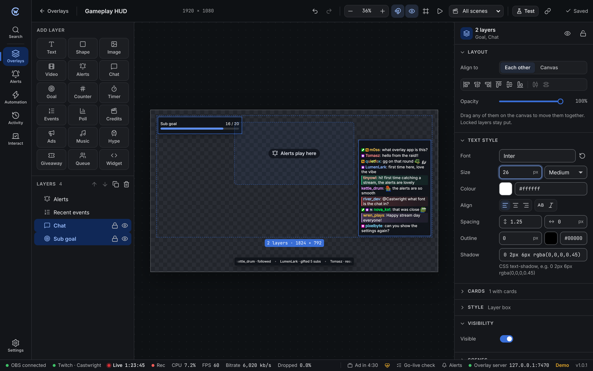
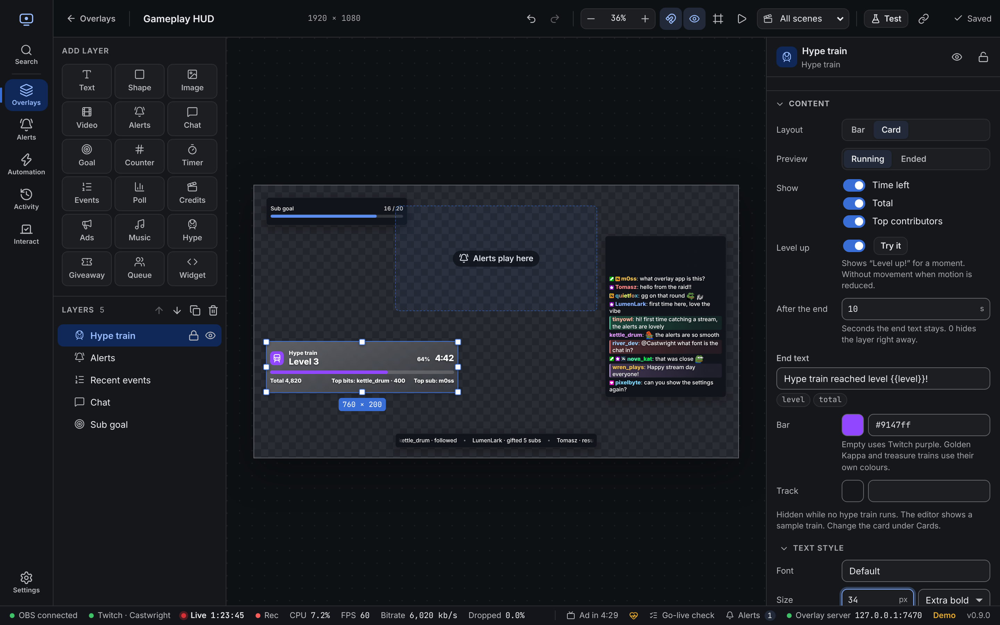

The editor shows your overlay exactly as OBS will, with live chat, events and variables.

- **Left**: add layers, and the **Layers** list (front first).
- **Middle**: the canvas.
- **Right**: settings for the selected layer, or for the overlay when nothing is selected. Drag the dividers to make either side wider; sections fold with a click on their title.

## Layer types

| Layer | What it shows |
| --- | --- |
| **Text** | Fixed text or live values like `{{last.follow.name}}`. See [templates](/reference/templates/). |
| **Shape** | Rectangle, ellipse or line. Good for backgrounds and frames. |
| **Image** | A logo, frame or picture from your project files. |
| **Video** | A looping video or animation. |
| **Alerts** | Where alerts play. Design them on the [Alerts](/guide/alerts/) page. |
| **Chat** | Live chat with Twitch and 7TV badges, 7TV name paints and 7TV, BetterTTV and FrankerFaceZ emotes. Hides bots and commands, and highlights messages. See [Chat layer filters](#chat-layer-filters). |
| **Goal** | A progress bar towards a target, such as follows or bits this stream. |
| **Counter** | A number from a [variable](/reference/variables/), like a death counter. |
| **Timer** | Countdown, stopwatch, clock or stream uptime. See [Timer controls](#timer-controls). |
| **Events** | Recent follows, subs, cheers and more, as a list or ticker. |
| **Music** | The song playing now, with cover and progress. See [Music and now playing](/guide/music/#now-playing-layer). |
| **Hype** | The running hype train: level, progress, time left and top contributors. See [Hype train layer](#hype-train-layer). |
| **Giveaway** | The prize and entries, then a spin that lands on the winner. See [Giveaways and queue](/guide/giveaways-queue/#overlay-layers). |
| **Queue** | Who's playing now and who's next in the viewer queue. |
| **Credits** | An end-of-stream roll of everyone who followed, subbed, gifted, cheered, raided or chatted. See [Credits layer](#credits-layer). |
| **Widget** | Your own HTML, CSS and JavaScript. See [custom widgets](/reference/custom-widgets/). |

## Styles

Pick a ready-made look under **Style** (the layer's box) or **Cards** (each chat message or event row): Clean, Comic, Speech bubble, Sticker, Riot, Neon, Pixel, Glass, Paper, Outline, Terminal and Candy. Every preview is drawn with your real layer.

After picking one, change any part of it:

| Group | What you can change |
| --- | --- |
| **Shape** | Square, rounded, pill, speech bubble with a tail, slanted, cut corners or pixel steps. Corner size, padding and lean. |
| **Fill** | One colour, a gradient or none, opacity and blur behind. |
| **Pattern** | Halftone dots, stripes, grid or paper grain on top of the fill. |
| **Border and stripe** | Width, colour and line (solid, dashed, double or thick ink), plus a coloured stripe on one side. |
| **Shadow** | Soft, hard offset (comic), glow, layered or your own. |

**Cards** also has: lean in turn (every other message tilts the other way, like stickers), a wash of each chatter's name colour, card around the whole message or just the words, and the gap between cards.

## Long text

Under **Text style**, **Long text** sets what happens when text doesn't fit its layer, like a long song name:

- **Wrap**: moves onto the next line.
- **Cut off**: stays on one line and ends with "…".
- **Scroll**: slides sideways in a loop, pausing at the start each time. Set the speed next to it. Text that fits stays still.

Scrolling turns into **Cut off** when the computer has reduced motion turned on.

## Moving and sizing

- Drag a layer to move it, and the handles to resize. Hold **Shift** to keep its shape.
- Layers snap to the canvas edges, its centre and other layers. Hold **Ctrl** (**⌘** on Mac) to place freely, or turn snapping off in the top bar.
- **Alt**-click picks the layer underneath.
- Type exact numbers under **Layout**: position, size, rotation and opacity. The align buttons line a layer up with the canvas.
- Right-click a layer on the canvas or in the Layers list to copy, paste, duplicate or delete it.

## Editing several layers

Pick more than one layer to change them together:

- **Shift** or **Ctrl** + click layers on the canvas or in the Layers list. Click a picked one again (with **Shift** or **Ctrl**) to drop it.
- Drag on an empty part of the canvas to pick every layer the box touches.
- **Ctrl + A** picks every layer.

Drag any picked layer to move them all. Arrows, **Delete**, **Ctrl + D**, **Ctrl + C** and **Ctrl + V** work on all of them. Pasting works in another overlay too.

The right side then shows what they share:

| Section | What it does |
| --- | --- |
| **Layout** | Line them up with each other or the canvas, space three or more evenly, and set the opacity. |
| **Text style** | Font, size, weight, colour and the rest, for every picked layer with text. In credits, the titles and heading keep their size next to the names. |
| **Cards** | Card styles for chat, events and other card layers. |
| **Style** | Box styles and the box settings. |
| **Visibility** and **Scenes** | Show or hide them, and their scene rules. |

Fields where the layers differ show **Mixed**. Typing a value sets it on all of them. Every change is one undo step. Alert text is styled on the [Alerts](/guide/alerts/) page, so Alerts layers aren't changed by **Text style**.

## Layer settings

Each layer has these sections on the right:

| Section | What's in it |
| --- | --- |
| **Content** | What the layer shows: text and font, image, chat options, goal target and so on. |
| **Style** | Background, border, corners, padding, shadow and backdrop blur. |
| **Visibility** | **Only show when**: rules that hide the layer unless they match, for example `stream.live is true`. See [conditions](/reference/conditions/). |
| **Scenes** | Which OBS scenes show the layer. See [Scenes](#scenes). |
| **Animation** | How the layer enters, leaves and moves while shown. Click the play button next to each to preview it. |
| **Advanced** | Custom CSS for the layer, and its ID for automation. The list under the CSS box shows which classes this layer has; click one to insert a rule. See [Custom CSS](/reference/styling/). |

Hide a layer with the eye in the Layers list. The **Show/hide overlay layer** automation step can show it at certain moments, like after a raid.

## Timer controls

Countdown and stopwatch layers can be started, paused, resumed and reset:

- In the layer settings, under **Content → Control**.
- Right-click the layer on the canvas or in the Layers list.
- With the **Timer** [automation step](/reference/automation-steps/#overlays-and-alerts), which can also add or take off time.
- From a Stream Deck: **Copy link** under **Control** gives a link that pauses or resumes. See [Timer controls](/reference/http-api/#timer-controls) for the rest.

The app keeps the time, so every copy of the overlay shows the same, also after a reload. **Start** always starts from the beginning. **Reset** goes back to the beginning and waits. A countdown stops at `00:00`.

Until you start it, a timer works as before: it counts from when the overlay loads, or from its **Start from** variable. The time is kept while the app runs; after a restart, timers count from page load again until started.

## List order

Lists can grow from either end. Old layers keep how they looked.

| Layer | Setting | Options |
| --- | --- | --- |
| **Chat** | **New messages** | **At the bottom** (default) or **At the top**. |
| **Chat** | **Stack from** | The edge the messages sit against: **Bottom** or **Top**. Follows **New messages** until you change it. |
| **Events** (list) | **Newest** | **At the top** (default) or **At the bottom**. |
| **Events** (ticker) | **Moves** | **Left** (default) or **Right**. |
| **Credits** | **Scroll** | **Up** (default) or **Down**. Scrolling down, the heading still comes in first. |
| **Viewer queue** | **First in line** | **At the top** (default) or **At the bottom**. At the bottom, the layer reads bottom up. |

New messages and events slide in from the edge they appear at. To style each order, use `data-order` and the other attributes in the [styling reference](/reference/styling/).

## Chat layer filters

Under **Content → Filters**, pick which hide and highlight rules the layer uses:

| Rules | |
| --- | --- |
| **App** | The rules in [Settings → Chat filters](/guide/settings/#chat-filters), shared with the chat panel. The default. |
| **Own** | Rules for this layer only. The full rule list shows right there. |
| **None** | No rules, apart from the switches below. |

**Hide !commands** and **Hide bots** always apply, whichever rules you pick. **Hide users** adds names on top.

Highlighted messages get a coloured bar and a soft tint. Restyle them with the `.cw-hl-…` classes in the [styling reference](/reference/styling/#chat).

## Now playing layer

Shows the song from [Settings → Music](/guide/music/), in a compact, card or vinyl layout. It can hide while nothing plays and slides in each new song. See [Music and now playing](/guide/music/#now-playing-layer).

## Hype train layer

Shows the hype train while one runs, and hides itself the rest of the time.

| Setting | What it does |
| --- | --- |
| **Layout** | **Bar**: one thin line, made for the top of the screen. **Card**: the kind of train, level, bar, total and top contributors. |
| **Show** | Time left, the total, and the top bits and sub contributors. |
| **Level up** | Shows "Level up!" for a moment when the train reaches a new level. **Try it** plays it on the canvas. |
| **After the end** | Seconds to show the end text once the train is over. `0` hides the layer right away. |
| **End text** | Like `Hype train reached level {{level}}!`. `{{total}}` works too. |
| **Bar** and **Track** | Bar colours. Golden Kappa trains get gold and treasure trains teal. |

**Preview** switches the canvas between a running and an ended train. While no train runs, the editor shows a sample one. Pick a card look under **Cards**.

Golden Kappa, treasure and shared trains get their own class, like `.cw-hype-golden`, and the card shows what kind it is. With *reduced motion* on, "Level up!" shows without the pop and flash. See the [styling reference](/reference/styling/#hype-train).

The layer reads the [`hype.*` variables](/reference/variables/#hype-train), so text layers can show the same values.

## Giveaway and queue layers

The **Giveaway** layer shows the prize and entry count, then spins to the winner. The **Viewer queue** layer shows who's playing and who's next. See [Giveaways and queue](/guide/giveaways-queue/#overlay-layers).

## Credits layer

A movie-style roll of the people who made this stream. Names come from the live stream, or the last one if you're offline.

**Sections**: new followers, subscribers (new and resubs, with months), gifted subs (with counts), cheers (with bits), raids (with viewers), moderators and VIPs who chatted, and top chatters (with message counts). Turn each on or off, rename it, or move it up and down. Empty sections are skipped.

| Setting | What it does |
| --- | --- |
| **Starts** | **When shown**: rolls as soon as the layer appears. **From an action**: stays empty until the **Roll credits** step runs. |
| **Speed** | Pixels per second. Or set **Fit to seconds** to make one pass take that long. |
| **Scroll** | **Up** or **Down**. See [List order](#list-order). |
| **At the end** | **Stop** keeps the last names on screen. **Loop** starts again. |
| **Heading** and **Footer** | Text above and below the names. Live values work, like `{{session.follows}}`. |
| **Names** | **Plain** uses the name text style. **Like chat** adds chat colours and badges (for people who chatted recently) and 7TV paints. |
| **Columns**, **Fade edges**, **Amounts** | Names in 1 or 2 columns, a soft fade at the top and bottom, and months, gifts, bits and so on next to names. |

**Roll now** plays it on the canvas. With no stream yet, the editor shows sample names.

With *reduced motion* turned on in the system or browser, the roll shows still pages instead of scrolling. **Page time** sets how long each page stays.

Style the names, section titles and heading under **Content**, and a card around each section under **Section cards**. The **Ending** template already has a credits layer.

## Scenes

One overlay can change with your OBS scene. For example, hide the webcam frame on your BRB scene, or show a "Starting soon" banner only on the starting scene.

Open **Scenes** on a layer and pick one:

| Option | The layer shows |
| --- | --- |
| **Show in all scenes** | Everywhere. This is the default. |
| **Only in these scenes** | Only in the ticked scenes. |
| **Hide in these scenes** | Everywhere except the ticked scenes. |

Tick scenes from OBS's list. If OBS isn't connected, type the name and press **Enter**. Names must match OBS exactly, including capitals.

Layers with a rule get a small clapper icon in the Layers list.

**Coming and going.** When the scene changes, the layer plays its own enter and exit animations. If it has none, it uses the **Transition** set here: fade, slide, scale or none, with a duration. If your computer asks for reduced motion, slides and scales become fades.

**Which scene counts.** The program scene: what's live on stream. In Studio Mode, the preview scene doesn't count. While OBS isn't connected, every layer shows as if it had no rule.

**With other visibility settings.** A layer shows only when all of these are true:

1. Its eye is on. The **Show/hide overlay layer** automation step changes this too.
2. Its **Only show when** conditions match.
3. Its scene rule allows the current scene.

So an automation step can't show a layer in a scene its rule hides it from. It just stays hidden until the scene allows it.

### Preview as scene

Pick a scene in **Preview as scene** in the top bar to see the canvas as it looks in that scene. Layers that scene hides are dimmed, not removed, so you can still select and edit them. Pick **All scenes** to go back.

## Fonts

Pick from the font list or type any [Google Fonts](https://fonts.google.com) name. With no layer selected, **Extra fonts** loads more fonts for custom widgets.

**Default** uses the project's [default font](/guide/settings/#default-font), set in **Settings → Appearance**. New layers start on it. The ↺ button next to a font switches it back to **Default**.

## Testing

**Test** in the top bar:

- **Play an alert** of any type, using your real alert designs.
- Add a sample chat message or event.
- **Preview values**: try different variable values, for example to see a goal at 75%. These only affect the editor.

The play button in the top bar starts and stops layer animations on the canvas.

## Top bar

| Control | What it does |
| --- | --- |
| ↶ ↷ | Undo and redo |
| − 37% + | Zoom. Click the number for **Fit to window** and other sizes. |
| Magnet | Snapping on or off |
| Eye | Show hidden layers on the canvas |
| Frame | Safe area guide, to keep things away from the edges |
| ▶ | Play or pause animations |
| Clapper | **Preview as scene**: dims layers the chosen scene hides |
| **Test** | Test alerts, chat and values |
| Link | Copy the OBS link |

## Shortcuts

| Keys | Action |
| --- | --- |
| Arrows | Nudge 1 px (**Shift**: 10 px) |
| **Shift** or **Ctrl** + click | Pick several layers |
| Drag on empty canvas | Pick layers with a box |
| **Ctrl + A** | Pick every layer |
| **Ctrl + C** / **Ctrl + V** | Copy and paste layers |
| **Ctrl + D** | Duplicate layer |
| **Ctrl + Z** | Undo |
| **Ctrl + Shift + Z** or **Ctrl + Y** | Redo |
| **Delete** / **Backspace** | Remove layer |
| **Esc** | Deselect |
| Right-click a layer | Copy, paste, duplicate, delete, and start or pause timers |

On Mac, use **⌘** instead of **Ctrl**. Shortcuts don't fire while you're typing in a field.
