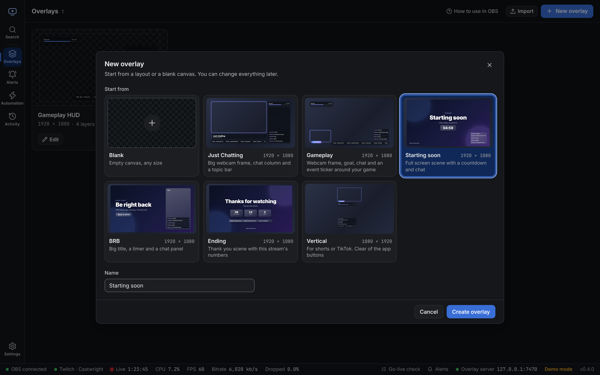

An **overlay** is a transparent page that sits on top of your video in OBS: alerts, chat, goals, timers, labels and anything else you design. Each overlay is one Browser Source in OBS.

## Create an overlay

Click **New overlay**, pick a layout, check the name and click **Create overlay**.

| Layout | What's in it |
| --- | --- |
| **Blank** | Nothing. You pick the size. |
| **Just Chatting** | Big webcam frame, topic bar, chat column, sub goal and recent events |
| **Gameplay** | Webcam frame with a name tag, sub goal, chat and an event ticker around your game |
| **Starting soon** | Full screen scene with a 5 minute countdown, chat and your socials |
| **BRB** | Big "Be right back" title, a timer and a chat panel |
| **Ending** | "Thanks for watching" with this stream's follows, subs and raids |
| **Vertical** | 1080 × 1920 for shorts or TikTok. Chat and events stay clear of the app buttons. |

Every layout has an alerts area. Change `@yourname`, `twitch.tv/yourname` and the rest in the [editor](/guide/overlay-editor/). Countdowns start when OBS loads the overlay; set the length on the Timer layer.

For **Blank**, pick a size:

| Size | Use it for |
| --- | --- |
| 1920 × 1080 | Most streams |
| 1280 × 720 | 720p streams |
| 1080 × 1920 | Vertical streams |
| Custom | Anything else, such as a webcam frame |

Use the same size as your OBS canvas (**Settings → Video → Base Resolution** in OBS) so layers line up.

### Your own templates

To reuse a layout, open **⋯** on its card and pick **Save as template…**. It shows under **Your templates** in **New overlay**. To delete one, hover it there and click the bin.

Templates are saved in the project's `templates/` folder as [`.cwoverlay` files](/reference/files/#cwoverlay-files), with the images and other files they use.

## Put it in OBS

Each card has:

| Button | What it does |
| --- | --- |
| **Edit** | Opens the [editor](/guide/overlay-editor/). |
| **Copy OBS link** | Copies the overlay link for a Browser Source. |
| **Add to OBS** | Adds a Browser Source to a scene for you, at the right size. Needs OBS connected. |
| **⋯** | Duplicate, save as template, export or delete. |

Adding by hand:

1. In OBS, click **+** under **Sources** and choose **Browser**.
2. Paste the link into **URL**.
3. Set **Width** and **Height** to the overlay size.
4. Tick **Control audio via OBS** if the overlay plays alert sounds.

You can use one overlay in many scenes. Edits appear in OBS straight away, no refresh needed.

## Share overlays

- **Export** saves the overlay and the files it uses as a `.cwoverlay` file.
- **Import** on the Overlays page adds one to your project.

## Overlays and Castwright

OBS loads overlays from Castwright, so keep Castwright running while you stream. If it closes, overlays stop updating and reconnect by themselves once it's back. If you opened OBS before Castwright, right-click the Browser Source and choose **Refresh**.
