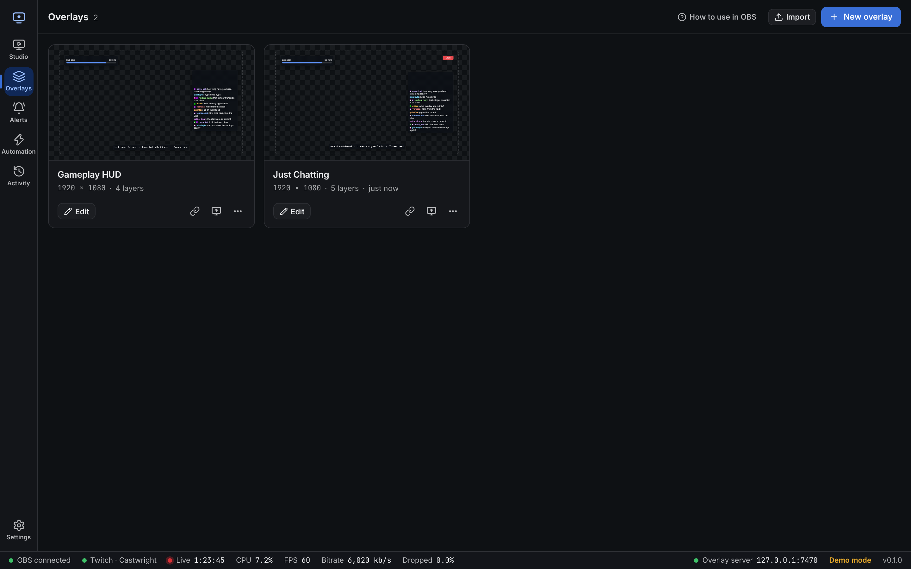

An **overlay** is a transparent page that sits on top of your video in OBS: alerts, chat, goals, timers, labels and anything else you design. Each overlay is one Browser Source in OBS.

## Create an overlay

Click **New overlay**, pick a name and size, and start **Empty** or from the **Starter layout**.

| Size | Use it for |
| --- | --- |
| 1920 × 1080 | Most streams |
| 1280 × 720 | 720p streams |
| 1080 × 1920 | Vertical streams |
| Custom | Anything else, such as a webcam frame |

Use the same size as your OBS canvas (**Settings → Video → Base Resolution** in OBS) so layers line up.

## Put it in OBS

Each card has:

| Button | What it does |
| --- | --- |
| **Edit** | Opens the [editor](/guide/overlay-editor/). |
| **Copy OBS link** | Copies the overlay link for a Browser Source. |
| **Add to OBS** | Adds a Browser Source to a scene for you, at the right size. Needs OBS connected. |
| **⋯** | Duplicate, export or delete. |

Adding by hand:

1. In OBS, click **+** under **Sources** and choose **Browser**.
2. Paste the link into **URL**.
3. Set **Width** and **Height** to the overlay size.
4. Tick **Control audio via OBS** if the overlay plays alert sounds.

You can use one overlay in many scenes. Edits appear in OBS straight away, no refresh needed.

## Share overlays

- **Export** saves the overlay and the files it uses as a `.cwoverlay` file.
- **Import** on the Overlays page adds one to your project.

## Overlays and Castwright

OBS loads overlays from Castwright, so keep Castwright running while you stream. If it closes, overlays stop updating and reconnect by themselves once it's back. If you opened OBS before Castwright, right-click the Browser Source and choose **Refresh**.
