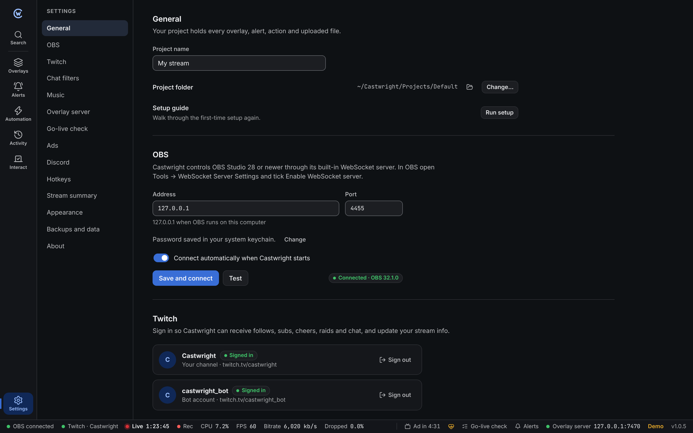
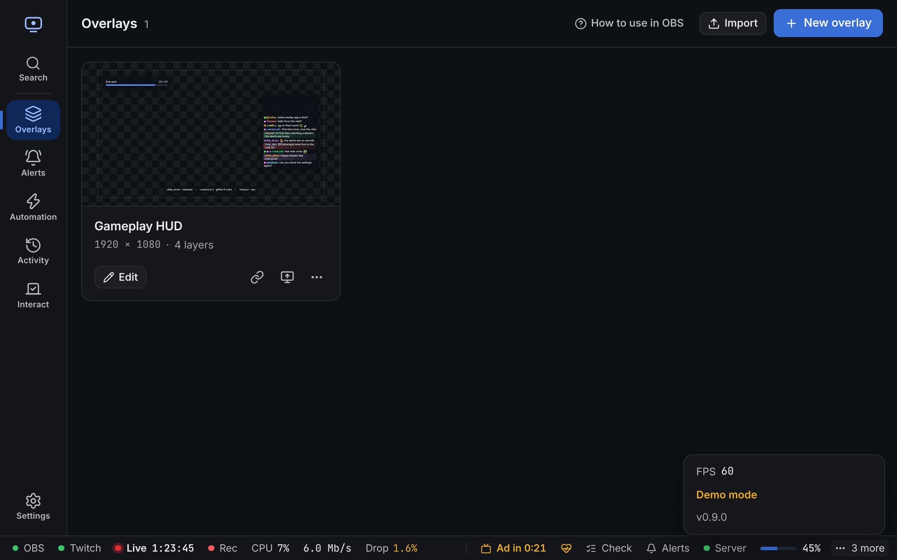
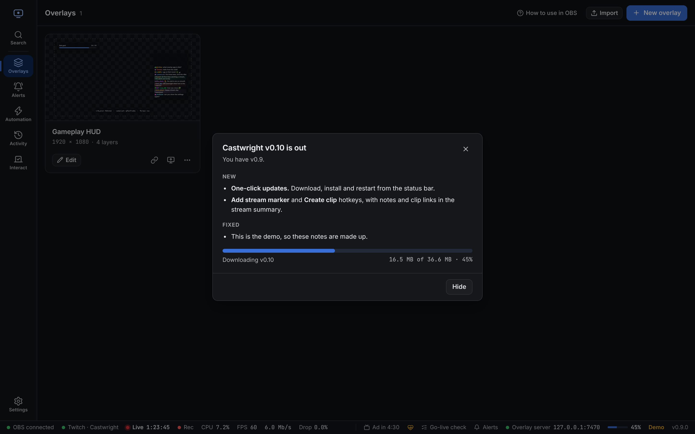

Open **Settings** from the gear at the bottom left, or press **Ctrl + ,** (**⌘ + ,** on Mac).



## General

- **Project name**: shown in backups.
- **Project folder**: where your overlays, alerts, actions and uploaded files are saved. Pick a synced folder (Dropbox, OneDrive) to keep a copy elsewhere. Changing it takes effect after a restart.
- **Run setup**: opens the [first-time setup](/guide/first-run/) again.

## OBS

Address, port and password for the OBS WebSocket server. **Test** checks them without saving. The password is kept in your system keychain (in [portable mode](#portable-mode), in the data folder). See [Connect OBS](/guide/first-run/#3-connect-obs).

## Twitch

Sign your channel in or out, and optionally a **bot account**. Automation chat messages can be sent as the bot, so viewers see them under its name.

If Twitch refuses some event types (usually after new permissions were added), sign out and in again.

### Twitch permissions

Your channel account asks Twitch for these permissions (scopes):

| For | Scopes |
| --- | --- |
| Events | `bits:read`, `channel:read:subscriptions`, `moderator:read:followers`, `channel:read:redemptions`, `channel:read:hype_train`, `channel:read:polls`, `channel:read:predictions`, `channel:read:charity`, `moderator:read:shoutouts` |
| Chat | `user:read:chat`, `user:write:chat`, `channel:bot`, `moderator:manage:announcements`, `moderator:read:chatters` |
| Mod tools | `moderator:manage:banned_users`, `moderator:manage:chat_messages`, `moderator:manage:chat_settings`, `moderator:manage:shield_mode` |
| Ads | `channel:read:ads`, `channel:edit:commercial`, `channel:manage:ads` (snoozing) |
| Stream | `channel:manage:broadcast`, `clips:edit`, `channel:manage:redemptions`, `channel:manage:polls`, `channel:manage:predictions`, `moderator:manage:shoutouts` |

The bot account asks for `user:read:chat`, `user:write:chat` and `user:bot`.

[Channel points, polls and predictions](/guide/interact/) use the redemption, poll and prediction scopes. [Ads](/guide/ads-discord/) use the ad scopes.

When a new version needs a new permission, Castwright keeps working with your old sign-in. You're only asked to sign in again when you use something that needs it.

### Use your own Twitch app

Official builds come with a client ID, so you can skip this. If yours doesn't, or you prefer your own:

1. Go to [dev.twitch.tv/console/apps](https://dev.twitch.tv/console/apps) and click **Register Your Application**.
2. Name it anything, set **OAuth Redirect URL** to `http://localhost`, **Category** to *Broadcasting Suite* and **Client Type** to **Public**.
3. Copy the **Client ID** into Castwright and click **Save**.

Changing the client ID signs both accounts out.

## Chat filters

What the chat panel and chat layers hide and highlight: bots, `!commands`, users and words to hide, and first-time chatters, mentions, keywords, users, mods, VIPs and "Highlight my message" redemptions to highlight, each with a colour.

Write one entry per line. Words match whole words in any case. `/pattern/i` is a regular expression; patterns that could freeze chat, like `(a+)+`, are refused. See [Activity → Filters and highlights](/guide/activity/#filters-and-highlights).

## Music

Where the playing song comes from: **Spotify**, **This computer** or a **Text file**. See [Music and now playing](/guide/music/).

## Overlay server

OBS loads overlays from a small web server inside Castwright, at `http://127.0.0.1:7470` by default.

| Setting | Notes |
| --- | --- |
| **Port** | Change it if another program uses 7470. If the port is busy at start-up, Castwright tries the next few. |
| **Allow other devices** | Lets a phone, tablet or second PC on your network open overlays and run actions. Links then use this computer's network address. Off by default. |
| **Link secret** | A random code in every overlay link so other programs can't read your overlays. **New secret** disconnects every open overlay and breaks existing links, so add the overlays to OBS again afterwards. |

## Go-live check

Settings for the [go-live check](/guide/go-live-check/).

| Setting | Default | |
| --- | --- | --- |
| **Open when the stream starts** | On | Runs the check when you go live and opens it only if something fails. |
| **Your list** | empty | Your own tick boxes, like "Mic on". Up to 30. Ticks clear when the stream ends. |

## Ads

| Setting | Default | |
| --- | --- | --- |
| **Warn before ads** | On | A message with a **Snooze** button before each ad. Once per ad. |
| **Minutes before** | 1 | 1 to 15 |

Castwright never switches scenes for ads. See [Ads and Discord](/guide/ads-discord/#castwright-never-switches-scenes-for-ads).

## Discord

Webhooks that post when you go live and when you end. Each has its own messages, ping and **Send test** button. Links stay in your system keychain and are never in backups or exports. See [Ads and Discord](/guide/ads-discord/#discord).

## Hotkeys

Global hotkeys work even while a game or another app has focus.

| Hotkey | Does |
| --- | --- |
| **Replay last alert** | Plays the last alert again |
| **Skip alert** | Ends the alert on screen |
| **Pause or resume alerts** | Holds the queue, or lets it play again |
| **Mute or unmute alerts** | Silences alert sounds, videos and speech |
| **Open the go-live check** | Brings Castwright to the front and runs the [go-live check](/guide/go-live-check/) |
| **Add stream marker** | Adds a Twitch stream marker, like "Marker 3 · 1:23:45". A message lets you add a note for 10 seconds. |
| **Create clip** | Makes a Twitch clip of what just happened. A message shows the link when it's ready. |
| **Add action hotkey** | Runs an [automation action](/guide/automation/) you pick |
| **Add sound hotkey** | Plays a [soundboard](/guide/soundboard/) button you pick. You can also set it from the sound's editor. |

To set one:

1. Click the box next to it.
2. Press the keys, like <kbd>Ctrl</kbd> + <kbd>Alt</kbd> + <kbd>R</kbd>.
3. <kbd>Esc</kbd> cancels. <kbd>Backspace</kbd> clears the hotkey.

Rules:

- Use <kbd>Ctrl</kbd>, <kbd>Alt</kbd> or <kbd>Super</kbd> (<kbd>Cmd</kbd> on Mac) with the key, so normal typing still works. F1 to F24 and media keys work on their own.
- One combination can only do one thing.
- Shortcuts the app uses itself, like <kbd>Ctrl</kbd> + <kbd>K</kbd>, can't be used.
- If another app already uses a combination, Castwright says so next to it. Pick a different one.
- **Use global hotkeys** switches all of them off and on without losing them.

Hotkeys are saved on this computer, not in the project. An action hotkey runs the action even if the action is switched off.

:::note[Linux]
Global hotkeys need X11. On Wayland they may only work while an X11 app or game has focus, or not at all. Castwright shows a note when it detects Wayland.
:::

The browser demo saves hotkeys but can't listen for them.

## Stream summary

The text **Copy for socials** puts on your clipboard. Click a name under the box to add it, or type `{{placeholders}}` yourself. A preview shows the text for your last stream. **Use the default** puts the original text back.

The default:

```text
Thanks for hanging out! {{duration}} of {{category | default:"streaming"}} with a peak of {{peak_viewers | number}} viewers.
{{follows}} new follows, {{subs}} subs and {{bits | number}} bits. Top chatter: {{top_chatter | default:"nobody yet"}}.
```

Every placeholder is listed in [Templates](/reference/templates/#stream-summary). See [Activity](/guide/activity/#sessions-and-summary) for the summary itself.

## Themes

Pick **Match system**, one of the built-in themes, or your own. Every built-in theme passes WCAG AA contrast.

To make your own, hover a theme and click its copy button, or click **New theme**:

- Pick an **accent colour** and how strong it is.
- **Surface tint** colours the backgrounds slightly.
- Set **corner radius**, **density** and **font**.
- **Fine-tune individual colours** if you want full control.

The **Readability** table checks every text and background pair as you go and flags anything below the minimum.

Share a theme with **Export** (copies JSON) and **Import** (paste JSON or pick a `.json` file).

Also here:

- **Default font**: the font for overlay text set to **Default**. See [Default font](#default-font).
- **App font**: the font of Castwright itself. **Theme** uses the theme's font, or pick **Inter** or **System**.
- **Window background** (Windows only): Mica, Acrylic or Solid. Auto uses Mica on Windows 11.
- **Interface size**: 50% to 250%. <kbd>Ctrl</kbd> + <kbd>+</kbd> and <kbd>Ctrl</kbd> + <kbd>-</kbd> change it from anywhere, <kbd>Ctrl</kbd> + <kbd>0</kbd> resets it. On large screens (like 2560 × 1440) Castwright starts at 125%.
- **Reduce motion**: turns off animations in the app. Overlays keep theirs.
- **Status bar**: pick which extras show at the bottom: CPU, FPS, Bitrate, Dropped frames, Overlay server and Version.

### Default font

Every font picker has a **Default** choice: chat, alerts, text, event lists, credits and the rest. Text set to **Default** uses the font you pick here, so one change restyles all of it, in the app and in OBS.

- Type any [Google Fonts](https://fonts.google.com) name or a font on your computer.
- It's saved in the project, so backups and project copies keep it.
- New layers and alerts start on **Default**. Text that names a font, like older layers set to **Inter**, keeps it.

### Status bar

The bar at the bottom shows your stream on the left (OBS, Twitch, live time, stats) and the app on the right (ads, health, go-live check, alerts, overlay server, updates).

When the window gets narrow or you zoom in:

1. Numbers shorten first, like **6.0 Mb/s** instead of **Bitrate 6,020 kb/s**. Hover for the full text.
2. Then less important items move into **More** (**3 more**). Click it to see them. They still work from there.

These never move into More: live and recording time, OBS and Twitch, health when it isn't green, an ad that's running or less than a minute away, paused or muted alerts, and **Restart to update**.

Use the arrow keys to move between items once one has focus.



## Backups and data

### Backups

Castwright backs up your project:

- when it starts
- once a day while it runs
- before a restore or import
- before an update converts your project to a new format
- before renaming a variable

A backup holds your overlays, alerts, actions and saved variables. Uploaded files, event history, passwords and sign-ins aren't included. If nothing changed since the last backup, no new one is made.

The list shows each backup's date, reason, project name and size.

| Button | Does |
| --- | --- |
| **Back up now** | Makes a backup straight away. |
| **Restore** | Puts that backup back. Your current project is backed up first, so you can undo it. |
| **Export** (arrow) | Saves a copy anywhere, for example a USB stick or cloud folder. |
| **Delete** (bin) | Removes that backup. |
| **Restore from file…** | Loads a `.cwbackup` file, or a `project.json` from any project folder. |
| **Open folder** | Shows the backups folder. |

How many are kept:

- **Daily backups**: days to keep, one backup per day. Default 14.
- **Other backups**: ones made with **Back up now** or before a restore, import, upgrade or variable rename. Default 5.

If a restore fails, your project stays as it was and the error says why.

See [Files and data](/reference/files/#backups) for where they're stored.

### Data

- **Reset session counters** sets this stream's follow, sub, bit and raid totals to zero.
- **Clear history** deletes saved events.

## About

Version, where settings are stored and links to this guide. **Health** and **Save bug report…** are here too, see [Health and bug reports](/guide/health/).

### Updates

Castwright checks for a new version once a day. When one is out, the status bar says so. Click it to see what's new and install it.

| Setting | Does |
| --- | --- |
| **Check for updates** | Checks now and opens the update window if there's a new version. |
| **Install updates automatically** | Downloads new versions in the background. They install the next time Castwright closes or restarts. Off at first. |
| **Update channel** | **Stable**: full releases only. |

In the update window:

- **Download and install** shows the download size and progress.
- **Restart to update** installs it and opens the new version.
- **Restart after stream** shows instead while you're live. Castwright asks again when the stream ends.
- If the download doesn't pass the signature check, it's thrown away and you'll see why. Use **Download from GitHub** then.

More in [Install → Updating](/guide/install/#updating).



### What's new

After an update, Castwright shows what changed in the new version once. It doesn't show on a new install. To see it again, click **What's new** in About, or pick **What's new** in the command palette (<kbd>Ctrl</kbd> + <kbd>K</kbd>). Every version is listed in the [changelog](/changelog/).

### Portable mode

Portable mode keeps all of Castwright's data in a `data` folder next to the app, so you can run it from a USB drive or move it between computers.

When it's on, **About** shows **Portable mode** and the data folder.

**Make portable…** copies your settings, default project, backups and sign-ins into that `data` folder. Your current data stays where it was. Restart Castwright to start using the copy.

The button is greyed out, with the reason under it, when:

- Castwright can't write to its own folder (for example `C:\Program Files` or `/usr/bin`). Move the app somewhere you own first.
- Something called `data` is already next to the app.

:::caution
In portable mode, passwords and sign-ins are kept in `data/secrets.json`. It isn't encrypted. Anyone who has the drive can use those accounts, so keep it safe.
:::

See [Install → Portable](/guide/install/#portable) and [Files and data → Portable mode](/reference/files/#portable-mode).
