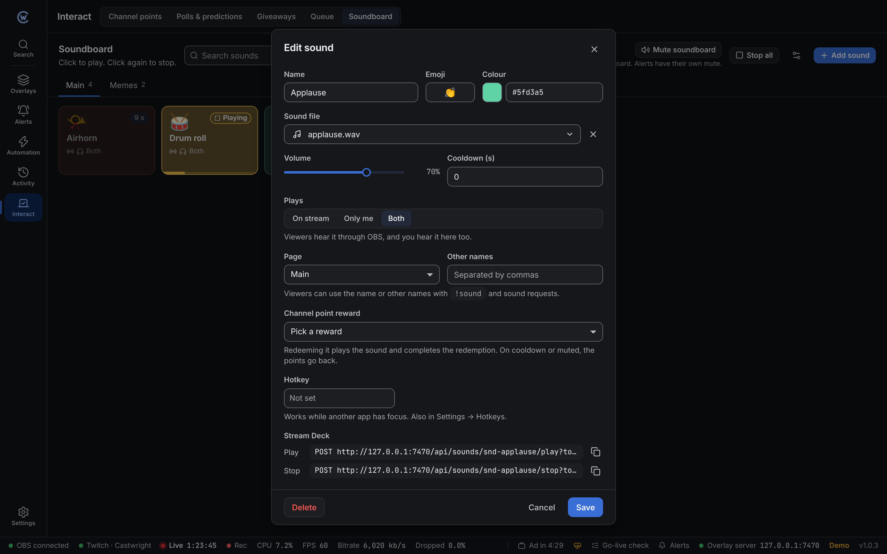

The soundboard is a grid of sound buttons. Open **Interact → Soundboard**. It works without a Twitch sign-in.

## Add a sound

1. Click **Add sound**.
2. Give it a name, and an emoji and colour if you like.
3. Click **Sound file** and pick a sound. Use the play button to hear it first, or **Add files** to bring in new ones.
4. Set the **Volume**, a **Cooldown** and where it **Plays**.
5. Click **Add sound**.

Click the pencil on a button (it shows on hover) to change or delete it.

## Where it plays

| Plays | Who hears it |
| --- | --- |
| **On stream** | Viewers, through OBS. You hear it only if you monitor the source in OBS. |
| **Only me** | Just you, in Castwright. Good for cues and reminders. |
| **Both** | Viewers through OBS, and you in Castwright. |

On stream sounds play in overlays that have an **Alerts** layer, the same as alert sounds. Keep one such overlay in each scene so a sound plays once. When none is open in OBS, the soundboard says so.

:::tip
In the overlay's Browser Source in OBS, tick **Control audio via OBS** to give the soundboard and alerts their own mixer slider.
:::

## Play and stop

- Click a button to play it. Click it again to stop it.
- A playing button shows **Playing** and a bar that fills as it plays.
- **Stop all** stops every sound, on stream and here.
- Playing a sound that's already playing starts it over.

## Cooldowns

| Cooldown | Where | What it does |
| --- | --- | --- |
| Per sound | The sound's editor | Seconds before that sound can play again |
| Global | **Soundboard settings**, the button left of **Add sound** | Seconds between any two sounds |

A cooling button shows the seconds left. Cooldowns apply everywhere: clicks, hotkeys, Stream Deck, actions, rewards and chat.

## Mute

**Mute soundboard** stops what's playing and keeps every sound quiet until you unmute it. Nothing plays, on stream or here.

It's separate from the alert mute. Muting alerts doesn't mute the soundboard, and muting the soundboard doesn't mute alerts. The mute is saved with the project.

## Pages, search and order

- **Pages**: add them in **Soundboard settings**, then pick a sound's page in its editor. Sounds on a removed page move to **Main**.
- **Search** looks through every page, by name, other names and file name.
- **Order**: drag a button onto another to put it there. With a button focused, <kbd>Alt</kbd> + <kbd>←</kbd> or <kbd>→</kbd> moves it too.

## Hotkeys

Open a sound's editor and click the **Hotkey** box, then press the keys. It works while another app, like a game, has focus. You can also add sound hotkeys in **[Settings → Hotkeys](/guide/settings/#hotkeys)**.

## Channel points

Twitch only lets Castwright complete or refund redemptions of rewards it made. Make the reward on the [Channel points](/guide/interact/#rewards) tab first.

**One reward per sound.** Pick it under **Channel point reward** in the sound's editor. Redeeming plays the sound and completes the redemption. If the sound is cooling down, the soundboard is muted or the sound has no file, the viewer gets the points back.

**Sound requests.** One reward where viewers type the sound they want:

1. Make a reward with **Viewer types a message** on.
2. Pick it under **Sound requests** in the soundboard settings.

The closest match plays, so `air horn`, `AIRHORN` and `airhrn` all find "Airhorn". **Other names** in a sound's editor add more names to match. No match, a cooldown or the mute refunds the points.

Rewards set to **Skip the queue** are complete as soon as they're redeemed, so they can't be refunded.

## Chat command

Turn on **Let chat play sounds** in the soundboard settings. Viewers then type `!sound airhorn`, and the closest match plays.

| Option | Default |
| --- | --- |
| Command | `sound` |
| Who can use it | Subscribers and up |
| Per-viewer cooldown | 30 seconds. Moderators and you skip it. |

Sound cooldowns and the mute still apply. Messages with no match are ignored.

## Stream Deck

Open a sound's editor. Under **Stream Deck**, copy the **Play** or **Stop** link and send it as a **POST** request. See [Stream Deck](/guide/stream-deck/#sound-buttons) and the [soundboard routes](/reference/http-api/#soundboard).

## Automation

The **Play soundboard sound** step plays a button with its own volume, output and cooldown. It fails while the soundboard is muted or the button is cooling down, and the run log says why.

The older **Play sound** step stays. It plays any file where alerts play, with no cooldown and no soundboard mute.

## In the browser demo

The demo has a few sounds made in the browser, so you can try it without files. On stream sounds can't reach OBS from the demo, so use **Only me** or **Both** to hear them.
