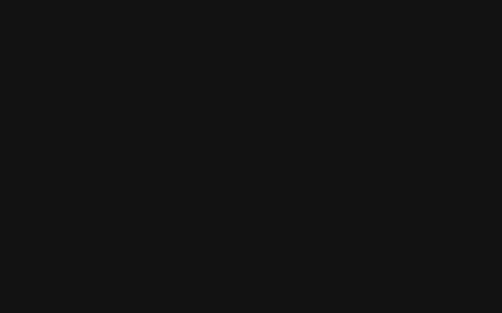

**Studio** is the main screen while you're live. Everything here controls OBS, so changes show up in OBS straight away and the other way round.

Studio needs OBS to be connected. If it isn't, you'll see a **Connect OBS** button instead.

## Going live

| Button | What it does |
| --- | --- |
| **Go live** / **End stream** | Starts or stops streaming in OBS. Ending asks to confirm first. |
| **Record** | Starts recording. While recording you can pause, resume or stop. |
| **Replay** / **Save replay** | Turns the OBS replay buffer on or off, and saves the last few seconds as a clip. Only shown if the replay buffer is set up in OBS. |
| **Virtual cam** | Turns the OBS virtual camera on or off. |

## Stream info

Click the title at the top left to change your **title**, **category** and **tags** on Twitch. Start typing a category to search for it.

## Previews and scenes

- The **Program** view shows what viewers see.
- Click a scene to switch to it. Keys **1** to **9** switch to the first nine scenes.
- Turn on **Studio mode** to line up a scene in **Preview** first. Pick a transition and length, then click **Transition** (or double-click a scene) to send it live.

## Sources

Lists the sources in the current scene. Click the **eye** to show or hide one, and the **lock** to stop it being moved by accident in OBS.

## Audio mixer

Each audio source has a level meter, a volume slider, a **headphones** button to listen to it yourself (monitoring) and a **speaker** button to mute it.

## Side panel

- **Viewers**, **bitrate** and **dropped frames** at a glance.
- **Event feed**: recent follows, subs, cheers and raids. Click ↺ to play an alert again.
- **Chat**: read and send chat. Turn on **Bot** to send as your bot account, if you signed one in.

The status bar at the bottom shows OBS and Twitch status, stream time, CPU, FPS and the overlay server address.
